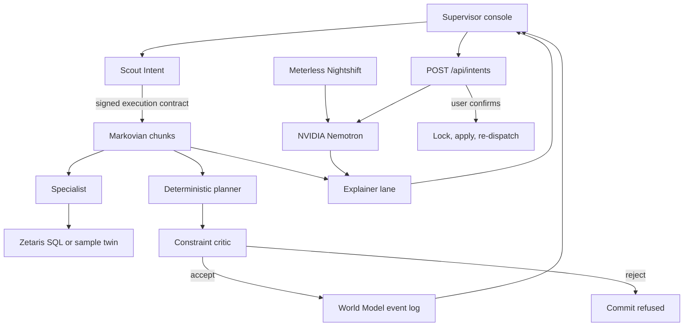

# ResiliMES

Autonomous multi-agent rescheduling and fault recovery for smart manufacturing. Built for the [Open Agent Hackathon 2026](https://hackathon.genai.works/event/open-agent-hackathon-2026).

A production supervisor gets a line-down, a rush order, a material shortage, a lithography rework, or a queue-time miss. ResiliMES reads the plant, classifies the disruption, builds a constraint-safe schedule, and shows the before/after Gantt with the KPI delta and the reason each move was allowed or refused.

**Primary track: Track 03 — Reasoning Architecture.** The product turns fragmented factory data, a signed intent contract, a world-model event log, and bounded agent steps into a schedule a supervisor can commit. Explainability is part of that decision, not a separate product. See [why this track](#track).

## Default scheduling mode: planning layer

ResiliMES now dispatches on the **planning layer** by default (demo, UI, API and studies that do not pin a mode). Before the run, `auto_plan` builds the plan from the run's own lots and dues. Dispatch then uses the plan's band and rank with the position-wait gate from planning-r1 (`plan_wait="position"`). Q-time r2 fix 2 (dynamic risk) and fix 3 (bounded tool holds) stay on. Fix 1 (shortlist admission) stays off, and the sched-freeze stays off. No weight, due or seed was tuned for this change.

`RESILIMES_SCHED_MODE=strict_qtime` (or `make_sim(..., sched_mode="strict_qtime")`) is the **strict Q-time** mode. It is the qtime-r2 fix-2 risk order without the plan, and it was main's ResiliMES path before this change. EDD, FIFO, CR and `smt_rule` never use the plan. The test suite pins `strict_qtime` (`tests/conftest.py`), so its recorded numbers and golden digests still apply. `tests/test_sched_mode.py` covers the default.

Why plan is the default: strict Q-time meets more Q-time windows, but it finishes far fewer lots. On the published book (7 days, seeds 1-3, closed fab, this code), per run:

| Mode | Completed/run | On-time % | True Q-time % | W. tardiness min/run |
|---|---|---|---|---|
| ResiliMES default (plan) | 503.7 | 91.96 | 94.63 | 20,950 |
| ResiliMES strict Q-time | 362.7 | 91.85 | 97.19 | 20,566 |
| EDD | 520.0 | 91.96 | 89.24 | 21,046 |

On this book the default ties EDD on on-time. It meets 5.4 pp more Q-time windows than EDD and completes 16 fewer lots per run. Across the 9-book × 5-seed study in [docs/PLANNING_R1_STUDY.md](docs/PLANNING_R1_STUDY.md) (7 d closed), the plan arm averages 455.7 completed/run, 94.5% true Q-time and 90.2% on-time. **EDD is about 3 pp better on on-time there (93.6%)** and completes 464.7/run at 88.8% true Q-time. Most of that gap comes from the X-factor books. The study arm ran with fix 1 on; the default keeps it off. The numbers further down this README were recorded before this change, on the strict path, and were not rerun.

## Default console: public industry benchmark (SMT2020)

`make demo` opens the public industry benchmark (SMT2020), not the six-lot bay. The extract is 106 station families, 1,313 tools, 102 `Litho_*` tools (82 expose scanners and 20 `Litho_REG`), 10 products, and 2,156 initial WIP lots. The banner reads `public industry benchmark (SMT2020)`. The lithography scenario holds `Litho_FE_92-1` for the published 705.59-minute lithography repair. Tool state is aggregated by station group; the Gantt is virtualized to the selected group and time window.

The honest comparison is the **X-factor book**: published routes and priorities, each due equal to remaining process time times 2.75, horizon 48 hours, 87 lots due, five seeds, `Litho_FE_92-1` down. On-time is the same at a 180, 300, 600, or 705.59 minute repair. At 600 minutes, ResiliMES is 87/87, 87/87, 83/87, 87/87, 87/87 (431/435, mean 99.08%) and EDD is 87/87, 87/87, 85/87, 87/87, 87/87 (433/435, mean 99.54%). **EDD is ahead by 2 pooled lots on this book**: on seed 3 the Q-time-urgent override makes two normal lots (`Init_Lot_2_13`, `Init_Lot_2_23`) 0.4-0.5 h late. Weighted tardiness is 11.5 minutes under ResiliMES and 0.78 under EDD. FIFO is 45.3% and CR is 76.1%, so ResiliMES beats both by a wide margin. Five-seed means: Q-time violations 231.2 under ResiliMES against 470.2 under EDD, and re-cleans 44.2 against 55.0. The console click is seed 1 of that book: both 87/87 on time, re-cleans 52 under EDD and 48 under ResiliMES, Q-time 492 under EDD and 244 under ResiliMES.

The **published-due** book is 48 hours and 56 lots, 10 of them already late at the snapshot, so the maximum on-time count is 46/56. **EDD beats ResiliMES on this book.** ResiliMES is 32 of 56 on every seed (160/280, mean 57.14%). EDD is 33, 32, 32, 32, 32 (161/280, mean 57.50%). CR and `smt_rule` tie ResiliMES at 160/280. Weighted tardiness is 20,098 minutes under ResiliMES and 19,702 under EDD. ResiliMES has fewer Q-time violations (187.8 against 421.6) and re-cleans (40.0 against 53.2) than EDD.

`smt_rule` is the dataset cascade in `tool.txt.1l`: `rule_HotLotFIRST` with `rank_HP;rank_RSETUP;rank_CR`, and `rule_LSSU` on Implant_128, Implant_132, and Implant_91. The idle-tool loop still picks the tool. Seeds 1-5 were scored once and not retuned. On published dues smt_rule ties ResiliMES on on-time (57.14%, 32/56 on every seed). Weighted tardiness is 19,341.0 minutes under smt_rule and 20,098.3 under ResiliMES. Q-time is 384.0 against 187.8. Re-cleans are 24.6 against 40.0. On the X-factor book at a 600-minute repair, ResiliMES on-time 99.08% beats smt_rule 74.94% (56/87, 64/87, 70/87, 65/87, 71/87).

The PM study shifts every day-based calendar so `Litho_FE_92_WK` opens at 2 hours, and every policy refuses a start that would cross a PM. ResiliMES: on-time 57.14%, weighted tardiness 20,842.4 minutes, Q-time 195.6, PM avoided 75.8, overlaps 0. EDD: on-time 57.86%, weighted tardiness 20,716.14 minutes, Q-time 433.6, PM avoided 92.4, overlaps 0. EDD is ahead by 2 pooled lots on that row. The unshifted 48-hour book has no PM events, because that weekly FOA sits outside 48 hours.

Seeds 9-13 control was regenerated by `make smt-bench`. X-factor: ResiliMES and EDD are both 435/435; Q-time 1,173 against 2,435, re-cleans 230 against 265. Published dues: ResiliMES and EDD are both 160/280 (32/56 on every seed); CR is 159/280. The expose-due and dry-etch arm table in [docs/SMT2020_SCALE.md](docs/SMT2020_SCALE.md) is a pre-fix lab note and was not recomputed.

**Tight VIP dues** rewrites the dues for a stress test. It is not the published order book. Eight lots at `Dielectric_BE_28` become VIP and are due at 8 hours. Thirteen normal lots in that same queue are due at 7.2 hours. `Dielectric_BE_28-1` is down for the published dielectric repair, 604.8 minutes. Denominator 21 lots per seed. ResiliMES is 6/21, 5/21, 5/21, 6/21, 5/21, 27/105 pooled. EDD is 3/21, 3/21, 1/21, 3/21, 3/21, 13/105 pooled. FIFO is 1/105. CR is 14/105. Seed 1 weighted tardiness is 7,471.6 under EDD and 3,573.8 under ResiliMES. On that seed `Init_Lot_2_13` is 5.66 hours late under EDD and on time under ResiliMES. The 13 normal lots in that queue give up 36.68 hours. The drill-down for this click is `Dielectric_BE_28-1` through `-3` over the full 24 hours.

**Simulator correctness fix.** An earlier build left a started lot in its old family queue, so a tool of the wrong family could start the lot's next step (1,762 such starts under ResiliMES and 1,905 under EDD on the published book, seeds 1-5). Every number above is after the fix. `make smt-invariants` replays every start of every book and policy through a trace checker; it now reports 0 violations. Root cause, checks, and the old-vs-new table are in [docs/invariants.md](docs/invariants.md).

**Operation logic (fab-logic-r1).** Every lot the dispatcher picks for a batch now starts (before, about half of the chosen lots were silently dropped). Same-recipe lots batch across operation numbers, wait for BATCHMN only while more lots of that recipe are due inside a look-ahead window and under a 30-minute cap (10 minutes with a hot or VIP lot), and the batch runs for its longest member. Setup time is charged. A breakdown sends the lot in process to a 30-minute rework hold, after which it redoes the step on any qualified tool. Sampled metrology runs only for the lots the lot-ID rule selects at the `StepPercent` rate. ResiliMES ranks by class tier (VIP, hot, normal) first, then lateness, then Q-time risk, setup, and slack. The numbers above are after these changes. Old against new, and why EDD now leads on published dues, are in [docs/FAB_LOGIC_R1.md](docs/FAB_LOGIC_R1.md).

**Q-time-urgent override and lot transport (qtime-urgent).** A ResiliMES lot whose open dataset CQT window has at most its remaining process time plus 15 minutes left jumps the class tier, but stays behind VIP and hot lots that are late or Q-time-urgent themselves. The same rule orders batches. Every override is logged and counted. Every policy now also moves a lot between tools in a fixed 1 minute (same SMT2020 station group) or 3 minutes (different group); Q-time keeps running during the move. The numbers above include both. Before and after, the split of the two effects, and the recommendation are in [docs/QTIME_URGENT.md](docs/QTIME_URGENT.md).

The WIP number on a ResiliMES run is a candidate cap: `choose()` keeps 8 lots instead of 24 once a family exceeds max(8, two lots per tool), and also keeps a lot whose slack is at or under 7200 seconds. It does not replan. The adjacent Wet_Etch look-ahead fired 0 times on the published books. On the pre-fix simulator, seeds 9–13, three arms were scored once: the slack exception matched the shipped score on both books, so it stays; a retarget onto the 44 adjacent 1-hour dry-etch to wet-etch pairs was reverted (it raised published-due Q-time from 1,821 to 1,850); and feeding the expose-step due into `dpi()` was reverted (X-factor on-time 407 to 420 of 435, published-due on-time 156 to 155 of 280). Those decisions were not rerun after the fix. `macro_aps_ms` places 30,625 scanner steps. That step count is the stable spec. The timer is about 0.3 s on the CI VM. It does not feed `dpi()`. `rank()` for ResiliMES uses the tiered key (`tiered_key`), not `dispatch_score`. Headline dispatch 0.0002 ms p50 and about 0.006 ms p95 includes empty wakes. Nonempty-queue decisions on the X-factor ResiliMES runs, seeds 1-5, recorded p50 0.0142-0.0156 ms and p95 0.1307-0.1500 ms. The 12-hour lithography click is a seed-1 tie, 2/19 under both policies. It is not the 48-hour five-seed lithography study, where EDD is slightly ahead (57.50% against 57.14%, 56 lots).

A down tool releases at the later end when a forced outage overlaps an MTTF draw. Queuing only the first end left some tools down for the rest of the horizon. That change left seeds 1–5 on-time on the X-factor book, the published-due book, and the tight book unchanged.

`make demo-live` is the same fab with Zetaris and Nightshift when those credentials are set. `make demo` does not call them. The film notes are in [docs/DEMO_SCRIPT.md](docs/DEMO_SCRIPT.md). Tables are in [docs/SMT2020_SCALE.md](docs/SMT2020_SCALE.md). What the extract contains and what the simulator leaves out is in [docs/SMT2020_PROVENANCE.md](docs/SMT2020_PROVENANCE.md).

`make demo-bay` is the six-lot sample used by the unit tests below.

## Sample bay (unit tests)

Sample fab FAB-A, scenario clock 22 Oct 2026 06:30 UTC. Machine breakdown (`litho_down`):

| KPI | Wait for repair | Rescheduled |
| --- | ---: | ---: |
| On-time delivery | 83.3% | 100% |
| Priority-weighted tardiness | 784 min (13 h 4 min) | 0 min |
| Makespan | 857 min | 328 min |
| Priority-1/2 lots at risk | 1 | 0 |

LOT-1001 is priority 1, blocked on LITHO-02 (laser fault, revised repair 600 minutes), due 18:00 UTC. Waiting finishes it 98 minutes late: the frozen book mounts RET-A28-L1-1 on LITHO-02, and that mount takes 5 minutes. The recovery moves the lot to LITHO-01, which shares `litho_193nm` and the setup family already on the tool, reuses the copy the running lot releases, and finishes it at t=253. A naive plan that starts the lot on the down tool immediately is rejected. A second L1 copy is free, so the refusal is the tool status. Lithography stays the bottleneck, and the move keeps it on an up tool.

A sixth preset, **Scale**, is a separate seeded fab of 1,000 lots and 36 tools. Ordinary lots carry 14 days of slack, and up to 24 priority-1 lots are pinned on the down scanner. It ties EDD on on-time delivery and weighted tardiness, so it is performance data only and it was not retuned. The table is in [docs/SCALE_APPENDIX.md](docs/SCALE_APPENDIX.md). The six-lot `litho_down` baseline is still a frozen assignment. The SMT2020 lithography and X-factor baselines are EDD.

The committed book stays that list scheduler. An optional CP-SAT model of the same rules is the optimality reference: tool eligibility, inhibits, family-change setups, down windows, one physical reticle copy per scanner, release times, re-entrant routes, queue-time max lag, and material holds. The objective is the same priority-weighted tardiness, with makespan as the tie-break. Held lots are scored the same way as the KPI: no finish time is invented for them. The console prints the gap on the chart row. On the six-lot stories the search proves the list scheduler's weighted tardiness. Lithography and the stockout match makespan as well. The rush book keeps tardiness at 288 minutes and shortens makespan from 342 to 293. Overlay rework shortens makespan from 402 to 326. Queue time shortens makespan from 285 to 256. On the 1,000-lot fab the two-second neighborhood does not beat the list schedule, so makespan stays 5,116 and the badge says the heuristic was kept. The list schedule is ready first, and it is what the cards commit. Analyze lists the steps the reference moved. Without OR-Tools the gap line stays hidden and recovery still completes. CI installs `ortools`. Locally it is the `solver` extra.

The other sample disruptions are one click away. A three-hour rush order finishes 36 min late. The running lot stays on LITHO-01 with RET-A28-L1-1. The spare copy exposes the hot lot on LITHO-02, and the rest of the route still misses the due. A photoresist stockout holds the lots which still need lithography. An overlay fail on LOT-1004 strips the resist, re-exposes once, and measures again. A second loop is not inserted. A queue-time miss holds LOT-1003 because the wet clean finished before the clock and the next film would start after a 15-minute window. The critic refuses that late deposition start.

## Architecture



Nemotron turns a dispatcher sentence into one tool call, and later turns the engine result into a business note. Every number in that note is checked against the engine. The committed plan comes from a list scheduler. CP-SAT scores that same objective, and the critic checks both books. That split is the reliability argument for Track 03.

| Piece | Role |
| --- | --- |
| Scout Intent | Classifies the disruption, checks role, surface, and prompt injection, and signs an execution contract. Downstream engines refuse unsigned, expired, or out-of-scope contracts. |
| Specialist | Reads equipment, WIP, routes, materials, and maintenance. In live mode those reads are Zetaris SQL. In mock mode the same SQL is recorded and answered from `data/sample`. |
| Planner | Builds the frozen schedule and the recovered schedule. A labeled safety-test alternative gives the critic something real to reject. That alternative is not a model proposal. |
| Critic | A registry of independent checks: tool status, capability, overlap, WIP, operators, material, route order, preemption, queue time, rework limit, reticle, tool inhibit, and lot release. A hold is listed and does not by itself reject the book. |
| Markovian | Runs sense → plan → critique → explain → commit as bounded chunks. Each chunk sees a checkpoint, not the growing transcript. The size comparison is `len(json) // 4`, not a model token count. |
| World Model | Append-only plant log. Assignments are ingested under the contract and replayed. |
| Nightshift | OpenAI-compatible hotspot. Nemotron parses dispatch intents and writes feedback and the supervisor narrative when a runtime token is configured. The planner and the critic stay deterministic code. A Nightshift outage uses the regex parser and the deterministic narrative, and that fallback is labeled. |

`POST /api/intents` validates the tool call, checks lot and tool ids, and asks Scout to sign. Nothing is applied until `POST /api/intents/confirm`. The confirm path takes a machine `lock_token`, applies the change, and re-dispatches. `check_inventory` runs the BOM check first. `notify_pe` is a trace line for the UI. It does not send email or any other message. The contract is [docs/API.md](docs/API.md). `REDIS_URL` selects `RedisStateStore` for that same engine. Empty keeps the in-memory store.

Nightshift can point `NEMOTRON_MODEL` at a local on-prem model and keep the same lanes. This repo does not add a second client for that. Nightshift stays the provider.

Details: [docs/ARCHITECTURE.md](docs/ARCHITECTURE.md). Sponsor write-up: [docs/SPONSOR_TECH.md](docs/SPONSOR_TECH.md).

## Quick start

Python 3.11 or 3.12. On Debian or Ubuntu, `python -m venv` fails with `ensurepip is not available` until the venv package is installed (`sudo apt install python3-venv`, or `python3.12-venv` for that interpreter).

```bash
python -m venv .venv
source .venv/bin/activate
pip install -r requirements-dev.txt
make demo
```

Open http://127.0.0.1:8000. Choose a disruption. The console waits, so the stack light and the agent loop are visible when you click. No API keys are required. The amber banner means both providers are on their offline twins. In mock mode the stream pauses about 680 ms between real steps so a recording can read them. Pass `pace_ms: 0` to `POST /api/recover/stream` to skip that pause.

Headless check:

```bash
make smoke
python -m resilimes recover --scenario litho_down
```

Docker:

```bash
docker build -t resilimes .
docker run --rm -p 8000:8000 resilimes
```

The image sets `RESILIMES_MODE=mock`.

## Switching from mock to Nightshift and Zetaris

`RESILIMES_MODE=auto` (the default if you do not use `make demo`) turns each provider on independently when its credentials exist.

1. Install a NVIDIA Nemotron model in [Meterless Nightshift](https://meterless.ai/) and copy the runtime token from `<stateDir>/proxy-token`. Do not use the placeholder `rt-local`.
2. Set `METERLESS_BASE_URL`, `METERLESS_RUNTIME_TOKEN`, and `NEMOTRON_MODEL` to the id `GET /v1/models` returns.
3. Load Postgres and register the four datasources, then check, from `C:\code\ResiliMES-AI` in PowerShell:

```powershell
wsl -d Ubuntu -- bash scripts/zetaris_setup.sh
python scripts/check_zetaris_smt.py
```

The first command loads the sample warehouse and the full SMT2020 fab and registers `resilimes`, `fab_cmms`, `fab_erp` and `fab_ops`. It takes no arguments and reads the logins already in WSL (`~/.config/fab-mes/env`, `~/zetaris-platform/.env`); it never prints them. The second prints per-table row counts through Zetaris and `PARITY OK` against `data/smt2020`.

`.gitattributes` keeps every text file LF on Windows. A clone made before it may still hold CRLF copies (bash then fails with `set: pipefail: invalid option name`). Refresh them once from PowerShell (commit or stash local edits under `scripts/` and `data/` first):

```powershell
Remove-Item scripts\*.sh, data\sql\*.sql, data\smt2020\*
git checkout -- scripts data
```

The recipe is [docs/ZETARIS.md](docs/ZETARIS.md).

4. Set `ZETARIS_REST_URL`, `ZETARIS_ORG_ID`, `ZETARIS_API_KEY`, `ZETARIS_TABLE_SOURCES`, and `ZETARIS_TIMEOUT_S`. The SQL path default is `/sql-editor/sqls/run-query`.
5. Start with `make demo-live` or `RESILIMES_MODE=auto python -m resilimes serve`.

`RESILIMES_MODE=live` refuses to start the recovery loop unless both providers are configured. The full variable list is in [.env.example](.env.example). Nothing in that file is a real secret.

Live connectivity, with secrets staying in `.env`:

```bash
cp .env.example .env
python smoke_test.py
```

Mask the token if you film that command. The console never prints it. A recovery report includes the model id, lane, and latency, and only a 12-character prefix of the contract HMAC.

## Troubleshooting

### Windows reserved ports

On Windows with Hyper-V, WSL, or Docker, Windows may reserve TCP port ranges. Check them with:

```bat
netsh interface ipv4 show excludedportrange protocol=tcp
```

The range 8001–8100 is common. Nightshift's default 8088 can then fail with `listen EACCES ... 127.0.0.1:8088` in `%LOCALAPPDATA%\ai.meterless.runtime\logs\engine-0.log`.

Nightshift rewrites `config.toml` on every start, and its Console has no port setting. From an elevated (Administrator) PowerShell, reserve the default ports so Hyper-V and WSL dynamic reservations leave them free:

```powershell
net stop winnat
netsh int ipv4 add excludedportrange protocol=tcp startport=8088 numberofports=1 store=persistent
netsh int ipv4 add excludedportrange protocol=tcp startport=11435 numberofports=1 store=persistent
net start winnat
```

That keeps 8088 (the public API) and 11435 (Nightshift's internal fabric port) as administered exclusions. Restart Nightshift after the commands finish.

ResiliMES probes the one base URL in `METERLESS_BASE_URL`. The default is `http://127.0.0.1:8088/v1`. If Nightshift listens on a different port, set `METERLESS_BASE_URL` to that origin plus `/v1`.

## Usage

The console is the product. Five presets:

- **Machine breakdown** — LITHO-02 down for 10 hours. Compare “wait for repair” with a recovered schedule. Lithography is the bottleneck, and the recovery keeps it on an up tool.
- **Rush order** — insert priority-1 LOT-2001 due in three hours. The running lot keeps its scanner and one L1 copy. The spare copy exposes the hot lot on the other scanner. The promise is still 36 min late.
- **Material shortage** — RESIST-UV on hand is zero. Lots that still need lithography are held. LOT-1002 is already running and keeps its resist.
- **Overlay rework** — overlay failed on LOT-1004 at metrology. The book strips on the wet bench, re-exposes once, and measures again. The rework limit is 1. The re-measure bar is striped.
- **Queue time** — clean to the next film on PROD-B14 must start within 15 minutes. LOT-1003 already missed that window. A naive start at t=120 is refused.

Each layer of PROD-A28 is deposition, lithography (coat, expose, and develop as one step), overlay and CD metrology, etch, wet clean, and CMP. L2 repeats the six steps. DEP-01 runs the film. MEAS-01 measures. WET-01 strips and cleans. Lots released through CMP stay on the first layer today. Queue time is surface exposure: 480 minutes from clean end to the next deposition. On A28 that next film is DEP-L2, with CMP between them, so the limit covers the polish. The 15-minute scenario tightens the adjacent B14 pair, clean to the cap film. Each A28 layer has two physical reticles. A copy sits on one scanner at a time, and mounting it on a different scanner takes 5 minutes. Analyze shows compliance and the bottleneck. Verify lists every registered check. A lithography bar tooltip names the copy.

Or type an incident. Scout classifies it. A viewer role, or a prompt-injection attempt, is refused before any schedule is written.

```bash
python -m resilimes recover --scenario rush_order
python -m resilimes recover --incident "Machine ETCH-02 Down, repair ETA 300 minutes"
```

HTTP: `GET /api/health`, `GET /api/scenarios`, `POST /api/recover`, `POST /api/recover/stream` (server-sent steps, then the report), `GET /docs`.

## Tests

```bash
make check
```

That is ruff, mypy, and pytest. The Meterless engine proofs are:

| Engine | Test |
| --- | --- |
| Scout Intent (the required engine) | `tests/test_scout_engine.py` |
| World Model | `tests/test_engines.py` |
| Markovian | `tests/test_engines.py` |

`tests/test_recovery.py` runs the whole loop in mock mode, including the viewer refusal and the Zetaris header contract against a fake HTTP response.

## Repository layout

```text
resilimes/            Product: domain, engines, agents, API, console
agent/                Live connectors only: Nightshift client and Zetaris REST
data/sample/          Offline plant
data/sql/seed.sql     Zetaris DDL and inserts, generated from data/sample
data/sql/scale_seed.sql  Same catalog for the 1,000-lot fab
data/zetaris/         CSV twin of the sample tables
data/zetaris/scale/   CSV twin of the scale fab
prompts/              Specialist prompt. The recovery loop does not load it.
tests/                Unit and API tests
docs/                 Architecture, sponsor write-up, demo script, pitch, checklist
```

## Dependencies

Runtime (`requirements.txt`): `openai`, `python-dotenv`, `requests`, `fastapi`, `uvicorn`, `pydantic`.

Development (`requirements-dev.txt`): `pytest`, `ruff`, `mypy`, `httpx`, `ortools`. OR-Tools is optional at runtime (`pip install -e ".[solver]"`). The recovery path runs without it.

Verified on Python 3.12.3 with ruff 0.17.2. CI runs 3.11 and 3.12.

## Sponsor technology

| Layer | Technology | Where it shows up |
| --- | --- | --- |
| Data | Zetaris | The full SMT2020 fab master data (11 tables, 6,935 rows across the MES, CMMS and ERP datasources) loads through Zetaris: `resilimes/data/smt2020_sql.py`, `data/sql/smt2020_seed.sql`, `RESILIMES_SMT_SOURCE`. Plant reads: `agent/tools_zetaris.py`, `resilimes/data/zetaris_source.py`, `data/sql/seed.sql` |
| Power | Meterless Nightshift routing to NVIDIA Nemotron | `resilimes/llm/nightshift.py` |
| Engines | Scout Intent, World Model, Markovian | `resilimes/engines/` |
| Build | Cursor | This repository was written in Cursor: architecture, scheduler, engines, console, tests, and docs. |

The offline twins implement the same interfaces. Mock mode is labeled in the console and in every recovery report. It is not a silent fallback that pretends a model answered.

## Track

Track 03 — Reasoning Architecture.

The challenge is to turn data, knowledge, memory, and reasoning into reliable decisions and actions. ResiliMES does that for a named user: the production supervisor on shift when a tool fails. The decision is a schedule. The action is the set of assignments written to the world model. Memory is the event log and the Markovian checkpoint. The critic is what makes the decision reliable: an unsafe plan is not committed, including a plan that would look better on a KPI by preempting a running lot or starting work on a down tool.

Track 02 (explain why) is a property of the same loop, visible in the narrative, the rejected alternative, and the fact list. It is not the primary track, because the product is the decision, not only the explanation. Track 01 is how the specialist reads fragmented tables. Wildcard would score only the increment on a prior product and pays less; the git history of this repository starts inside the build window (first commit 22 Oct 2026 22:22 UTC, window opened 22 Oct 2026 00:00 UTC), so the whole system is window work.

## Team

Two people. Put both names on the slide deck and the HackOS form before you submit. Team composition locks when the first submission is created.

## Hackathon packet

- Rules: [docs/hackathon/HACKATHON_RULES.md](docs/hackathon/HACKATHON_RULES.md)
- Sponsor write-up: [docs/SPONSOR_TECH.md](docs/SPONSOR_TECH.md)
- Demo script (about 3 minutes): [docs/DEMO_SCRIPT.md](docs/DEMO_SCRIPT.md)
- Slide outline: [docs/PITCH_DECK.md](docs/PITCH_DECK.md)
- Submission checklist: [docs/SUBMISSION_CHECKLIST.md](docs/SUBMISSION_CHECKLIST.md)
- API assumptions: [docs/ASSUMPTIONS.md](docs/ASSUMPTIONS.md)

License: MIT.
