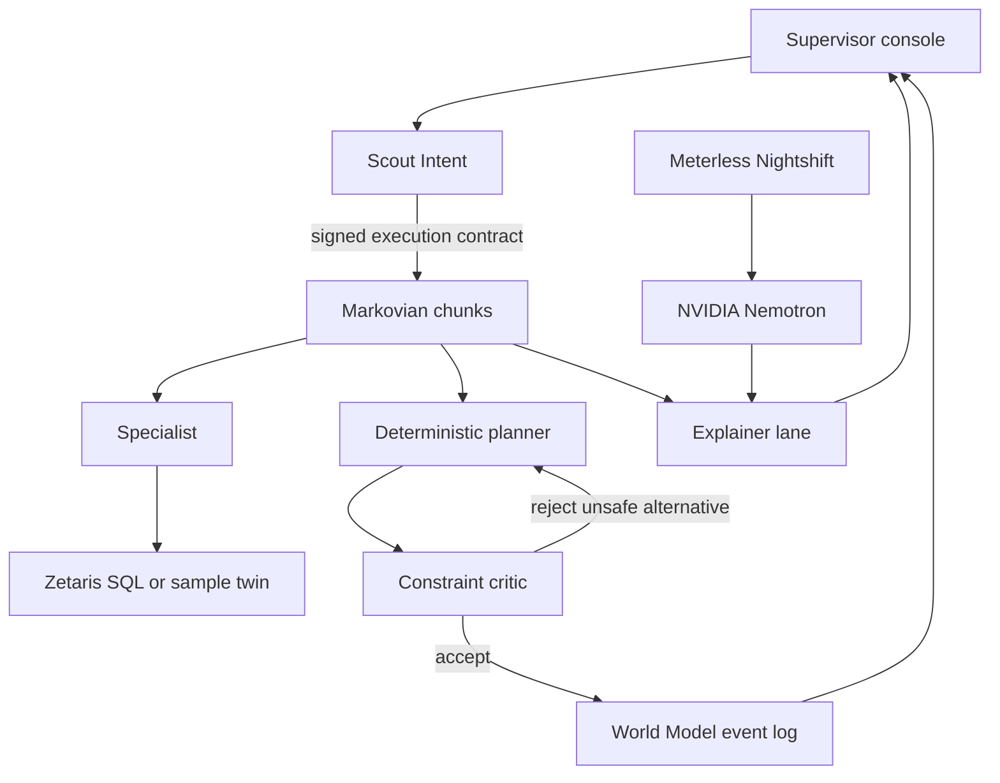

# ResiliMES

Autonomous multi-agent rescheduling and fault recovery for smart manufacturing. Built for the [Open Agent Hackathon 2026](https://hackathon.genai.works/event/open-agent-hackathon-2026).

A production supervisor gets a line-down, a rush order, a material shortage, a lithography rework, or a queue-time miss. ResiliMES reads the plant, classifies the disruption, builds a constraint-safe schedule, and shows the before/after Gantt with the KPI delta and the reason each move was allowed or refused.

**Primary track: Track 03 — Reasoning Architecture.** The product turns fragmented factory data, a signed intent contract, a world-model event log, and bounded agent steps into a schedule a supervisor can commit. Explainability is part of that decision, not a separate product. See [why this track](#track).

## What a disruption changes

Sample fab FAB-A, scenario clock 22 Oct 2026 06:30 UTC. Machine breakdown (`litho_down`):

| KPI | Wait for repair | Rescheduled |
| --- | ---: | ---: |
| On-time delivery | 83.3% | 100% |
| Priority-weighted tardiness | 744 min | 0 min |
| Makespan | 852 min | 328 min |
| Priority-1/2 lots at risk | 1 | 0 |

LOT-1001 is priority 1, blocked on LITHO-02 (laser fault, revised repair 600 minutes), due 18:00 UTC. Waiting finishes it 93 minutes late. The recovery moves it to LITHO-01, which shares `litho_193nm`, the setup family already on the tool, and reticle RET-A28-L1, and finishes it at t=253. A naive plan that starts the lot on the down tool immediately is rejected. That plan also asks for the reticle that is still on LITHO-01. Lithography stays the bottleneck, and the move keeps it on an up tool.

A sixth preset, **Scale**, is a separate seeded fab: 1,000 lots and 36 tools across deposition, lithography, metrology, etch, clean, and CMP, on the same per-layer route. The six-lot stories above stay as they are. LITHO-03 is down for 600 minutes, and 24 priority-1 lots are blocked on it. The baseline is EDD dispatch: earliest due date, then the qualified tool that can start soonest, with no priority weight and no bottleneck lookahead. Priority recovery is the committed book.

| KPI | vs. EDD dispatch | Priority recovery |
| --- | ---: | ---: |
| On-time delivery | 100% | 100% |
| Priority-weighted tardiness | 0 min | 0 min |
| Priority-1/2 lots at risk | 0 | 0 |

Both books clear the dues. EDD already sends the 24 priority-1 lots to scanners that are up, and priority recovery leaves those lots on the same scanners. Mean wait between steps falls from 392 minutes to 129. Makespan grows from 4,511 minutes to 4,974 because lower-priority lots wait. Schedule plus critic is about 0.7 seconds for 3,426 steps. Fourteen checks pass. The refused plan starts a blocked lot on LITHO-03 at time zero. Area utilization over the shared horizon stays near CMP 87.1%. The frame draws the first 12 hours as a per-tool load strip. LITHO-03 is hatched until the repair. CMP stays the bottleneck. The bay is staffed one operator per tool. `python scripts/export_scale_sql.py` writes `data/sql/scale_seed.sql` and `data/zetaris/scale/` for the same Zetaris catalog. The sample seed is unchanged. `pytest` skips the 1,000-lot timer unless `RESILIMES_BENCHMARK=1`. CI runs a 40-lot smoke of the same generator.

The other sample disruptions are one click away. A three-hour rush order finishes 1 h 13 min late: the running lot is not preempted, and its reticle cannot move to the other scanner until that exposure ends. A photoresist stockout holds the lots which still need lithography. An overlay fail on LOT-1004 strips the resist, re-exposes once, and measures again. A second loop is not inserted. A queue-time miss holds LOT-1003 because the wet clean finished before the clock and the next film would start after a 15-minute window. The critic refuses that late deposition start.

## Architecture



The language model explains a schedule it did not invent. The committed plan comes from a list scheduler. The critic is the gate. That split is the reliability argument for Track 03.

| Piece | Role |
| --- | --- |
| Scout Intent | Classifies the disruption, checks role, surface, and prompt injection, and signs an execution contract. Downstream engines refuse unsigned, expired, or out-of-scope contracts. |
| Specialist | Reads equipment, WIP, routes, materials, and maintenance. In live mode those reads are Zetaris SQL. In mock mode the same SQL is recorded and answered from `data/sample`. |
| Planner | Builds the frozen schedule and the recovered schedule. Also proposes a naive alternative so the critic has something real to reject. |
| Critic | A registry of independent checks: tool status, capability, overlap, WIP, operators, material, route order, preemption, queue time, rework limit, reticle, tool inhibit, and lot release. A hold is listed and does not by itself reject the book. |
| Markovian | Runs sense → plan → critique → explain → commit as bounded chunks. Each chunk sees a checkpoint, not the growing transcript. |
| World Model | Append-only plant log. Assignments are ingested under the contract and replayed. |
| Nightshift | OpenAI-compatible hotspot. The explainer calls NVIDIA Nemotron when a runtime token is configured. Nightshift explains. The planner and the critic stay deterministic code. |

Details: [docs/ARCHITECTURE.md](docs/ARCHITECTURE.md). Sponsor write-up: [docs/SPONSOR_TECH.md](docs/SPONSOR_TECH.md).

## Quick start

Python 3.11 or 3.12. On Debian or Ubuntu, `python -m venv` fails with `ensurepip is not available` until the venv package is installed (`sudo apt install python3-venv`, or `python3.12-venv` for that interpreter).

```bash
python -m venv .venv
source .venv/bin/activate
pip install -r requirements-dev.txt
make demo
```

Open http://127.0.0.1:8000. Choose a disruption. The console waits, so the stack light and the agent loop are visible when you click. No API keys are required. The amber banner means both providers are on their offline twins. In mock mode the stream pauses about 680 ms between real steps so a recording can read them. Pass `pace_ms: 0` to `POST /api/recover/stream` to skip that pause.

Headless check:

```bash
make smoke
python -m resilimes recover --scenario litho_down
```

Docker:

```bash
docker build -t resilimes .
docker run --rm -p 8000:8000 resilimes
```

The image sets `RESILIMES_MODE=mock`.

## Switching from mock to Nightshift and Zetaris

`RESILIMES_MODE=auto` (the default if you do not use `make demo`) turns each provider on independently when its credentials exist.

1. Install a NVIDIA Nemotron model in [Meterless Nightshift](https://meterless.ai/) and copy the runtime token from `<stateDir>/proxy-token`. Do not use the placeholder `rt-local`.
2. Set `METERLESS_BASE_URL`, `METERLESS_RUNTIME_TOKEN`, and `NEMOTRON_MODEL` to the id `GET /v1/models` returns.
3. Load the factory tables. Dry-run, then execute:

```bash
python scripts/load_zetaris.py
python scripts/load_zetaris.py --execute
```

4. Set `ZETARIS_REST_URL`, `ZETARIS_ORG_ID`, `ZETARIS_API_KEY`, and, if your tenant needs it, `ZETARIS_SQL_PATH=/sql-editor/sqls/run-query`.
5. Start with `make demo-live` or `RESILIMES_MODE=auto python -m resilimes serve`.

`RESILIMES_MODE=live` refuses to start the recovery loop unless both providers are configured. The full variable list is in [.env.example](.env.example). Nothing in that file is a real secret.

Live connectivity, with secrets staying in `.env`:

```bash
cp .env.example .env
python smoke_test.py
```

Mask the token if you film that command. The console never prints it. A recovery report includes the model id, lane, and latency, and only a 12-character prefix of the contract HMAC.

## Usage

The console is the product. Five presets:

- **Machine breakdown** — LITHO-02 down for 10 hours. Compare “wait for repair” with a recovered schedule. Lithography is the bottleneck, and the recovery keeps it on an up tool.
- **Rush order** — insert priority-1 LOT-2001 due in three hours. Running lots stay put, and the L1 reticle stays with them, so the promise is 1 h 13 min late.
- **Material shortage** — RESIST-UV on hand is zero. Lots that still need lithography are held. LOT-1002 is already running and keeps its resist.
- **Overlay rework** — overlay failed on LOT-1004 at metrology. The book strips on the wet bench, re-exposes once, and measures again. The rework limit is 1. The re-measure bar is striped.
- **Queue time** — clean to the next film on PROD-B14 must start within 15 minutes. LOT-1003 already missed that window. A naive start at t=120 is refused.

Each layer of PROD-A28 is deposition, lithography (coat, expose, and develop as one step), overlay and CD metrology, etch, wet clean, and CMP. L2 repeats the six steps. DEP-01 runs the film. MEAS-01 measures. WET-01 strips and cleans. Lots released through CMP stay on the first layer today. Queue time is surface exposure: 480 minutes from clean end to the next deposition. On A28 that next film is DEP-L2, with CMP between them, so the limit covers the polish. The 15-minute scenario tightens the adjacent B14 pair, clean to the cap film. RET-A28-L1 can be on one lithography tool at a time. Analyze shows compliance and the bottleneck. Verify lists every registered check.

Or type an incident. Scout classifies it. A viewer role, or a prompt-injection attempt, is refused before any schedule is written.

```bash
python -m resilimes recover --scenario rush_order
python -m resilimes recover --incident "Machine ETCH-02 Down, repair ETA 300 minutes"
```

HTTP: `GET /api/health`, `GET /api/scenarios`, `POST /api/recover`, `POST /api/recover/stream` (server-sent steps, then the report), `GET /docs`.

## Tests

```bash
make check
```

That is ruff, mypy, and pytest. The Meterless engine proofs are:

| Engine | Test |
| --- | --- |
| Scout Intent (the required engine) | `tests/test_scout_engine.py` |
| World Model | `tests/test_engines.py` |
| Markovian | `tests/test_engines.py` |

`tests/test_recovery.py` runs the whole loop in mock mode, including the viewer refusal and the Zetaris header contract against a fake HTTP response.

## Repository layout

```text
resilimes/            Product: domain, engines, agents, API, console
agent/                Live connectors only: Nightshift client and Zetaris REST
data/sample/          Offline plant
data/sql/seed.sql     Zetaris DDL and inserts, generated from data/sample
data/sql/scale_seed.sql  Same catalog for the 1,000-lot fab
data/zetaris/         CSV twin of the sample tables
data/zetaris/scale/   CSV twin of the scale fab
prompts/              Specialist prompt. The recovery loop does not load it.
tests/                Unit and API tests
docs/                 Architecture, sponsor write-up, demo script, pitch, checklist
```

## Dependencies

Runtime (`requirements.txt`): `openai`, `python-dotenv`, `requests`, `fastapi`, `uvicorn`, `pydantic`.

Development (`requirements-dev.txt`): `pytest`, `ruff`, `mypy`, `httpx`.

Verified on Python 3.12.3 with ruff 0.17.2. CI runs 3.11 and 3.12.

## Sponsor technology

| Layer | Technology | Where it shows up |
| --- | --- | --- |
| Data | Zetaris | `agent/tools_zetaris.py`, `resilimes/data/zetaris_source.py`, `data/sql/seed.sql` |
| Power | Meterless Nightshift routing to NVIDIA Nemotron | `resilimes/llm/nightshift.py` |
| Engines | Scout Intent, World Model, Markovian | `resilimes/engines/` |
| Build | Cursor | This repository was written in Cursor: architecture, scheduler, engines, console, tests, and docs. |

The offline twins implement the same interfaces. Mock mode is labeled in the console and in every recovery report. It is not a silent fallback that pretends a model answered.

## Track

Track 03 — Reasoning Architecture.

The challenge is to turn data, knowledge, memory, and reasoning into reliable decisions and actions. ResiliMES does that for a named user: the production supervisor on shift when a tool fails. The decision is a schedule. The action is the set of assignments written to the world model. Memory is the event log and the Markovian checkpoint. The critic is what makes the decision reliable: an unsafe plan is not committed, including a plan that would look better on a KPI by preempting a running lot or starting work on a down tool.

Track 02 (explain why) is a property of the same loop, visible in the narrative, the rejected alternative, and the fact list. It is not the primary track, because the product is the decision, not only the explanation. Track 01 is how the specialist reads fragmented tables. Wildcard would score only the increment on a prior product and pays less; the git history of this repository starts inside the build window (first commit 22 Oct 2026 22:22 UTC, window opened 22 Oct 2026 00:00 UTC), so the whole system is window work.

## Team

Two people. Put both names on the slide deck and the HackOS form before you submit. Team composition locks when the first submission is created.

## Hackathon packet

- Rules: [docs/hackathon/HACKATHON_RULES.md](docs/hackathon/HACKATHON_RULES.md)
- Sponsor write-up: [docs/SPONSOR_TECH.md](docs/SPONSOR_TECH.md)
- Demo script (about 3 minutes): [docs/DEMO_SCRIPT.md](docs/DEMO_SCRIPT.md)
- Slide outline: [docs/PITCH_DECK.md](docs/PITCH_DECK.md)
- Submission checklist: [docs/SUBMISSION_CHECKLIST.md](docs/SUBMISSION_CHECKLIST.md)
- API assumptions: [docs/ASSUMPTIONS.md](docs/ASSUMPTIONS.md)

License: MIT.
