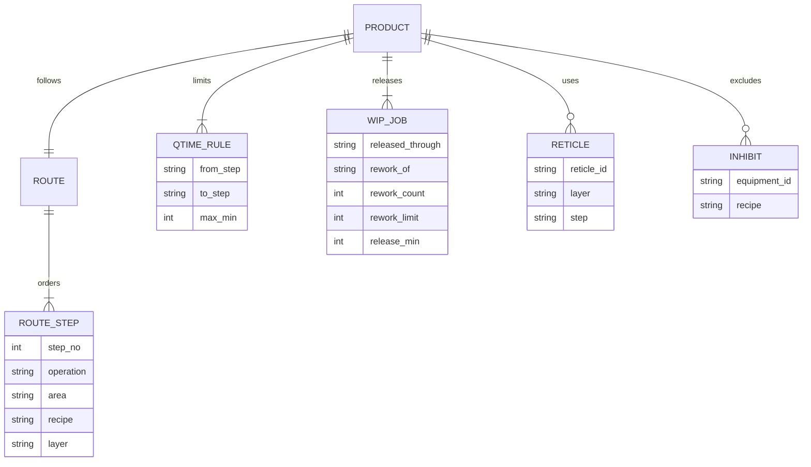
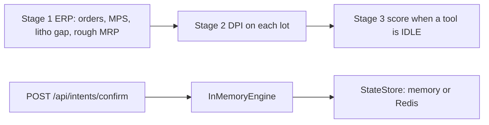

# Architecture

ResiliMES is a recovery loop for a shift supervisor. A disruption comes in. A signed contract comes out of Scout. Five Markovian chunks then sense the plant, schedule it, critique the schedule, explain it, and commit the assignments to an event log. The console renders the before and after.

## Clocks

The plant has a frozen scenario clock, default `2026-10-22T06:30:00Z`, because the sample WIP was generated at that moment. KPI math uses minutes from that clock.

Scout contracts use the wall clock. A contract TTL of five minutes is the public Scout default. Using the scenario clock would make every contract look expired on the day of the demo.

## Data

`Plant` is the in-memory snapshot: equipment, jobs, routes, queue-time rules, stock, operators, maintenance. Two sources build the same object.

A product follows one route. A route is an ordered list of operations. The same area can return on a later layer. Each layer of PROD-A28 is deposition, lithography, metrology, etch, wet clean, and CMP. L2 repeats those six steps. Coat, expose, and develop are one lithography step. Strip and the wet clean are one clean step. A lot released only through CMP is scheduled through the first CMP and does not enter L2 today. That is a release limit, not a second route. DEP-01, MEAS-01, and WET-01 are on the routes.

A queue-time rule says the start of `to_step` must be within `max_min` of the end of `from_step`. Steps may sit between the pair. The sample rule is surface exposure: clean end to the next deposition. On PROD-A28 that is CLEAN to DEP-L2, 480 minutes, and CMP is in between, so the limit covers the polish. On PROD-B14 the cap film follows the clean immediately. The queue-time scenario tightens that B14 rule to 15 minutes. LOT-1003's clean finished before 06:30, so the cap cannot start inside 15 minutes and the book holds the lot. PROD-A28 has two physical copies of each layer reticle, `RET-A28-L1-1` and `RET-A28-L1-2`, and the same pair for L2. A copy is on one scanner at a time. Mounting a copy that is not already on that scanner takes 5 minutes inside the slot. A recipe or a product can be inhibited on a tool. A lot's `release_min` is the earliest it may start; the sample is released at 0. The Zetaris tables add `reticle` and `inhibit`, plus `release_min` on `wip_jobs`. `data/sql/seed.sql` is generated from `data/sample`.

- `SampleSource` reads `data/sample` and records the SQL that Zetaris would have run.
- `ZetarisSource` runs that SQL through `agent.tools_zetaris.run_sql` and folds the rows with `plant_from_rows`.

The schema name is checked against `^[A-Za-z_][A-Za-z0-9_]*$` before it is interpolated. Statements are single `SELECT`s. Maintenance logs are read from datasource `fab_cmms`. BOM and materials are read from `fab_erp`. Every other plant table uses `ZETARIS_SCHEMA`. `scripts/zetaris_setup.sh` loads Postgres and registers those datasources. `scripts/load_zetaris.py` only points at that script. The recipe is `docs/ZETARIS.md`.

## Three-stage kernel

`schedule_plant` is still the book the console and `POST /api/intents/confirm` commit. `resilimes.kernel` scores a candidate (DPI, setup, PED, a PM window, a batch pack). It does not take the lock and it does not replace `InMemoryEngine`. Locks are `lock:{equipment_id}` through `StateStore.compare_and_set`. See [API.md](API.md).

Stage 1 reads SMT2020 release intervals into `orders`. It builds a shift release plan, a coarse litho capacity gap, and a rough material check. A product with no BOM is `unchecked`. Customers are `derived:<order id>`. Margin tier is `unpriced` unless a row says `high`.

Stage 2 writes `DPI = w1·LotValue + w2·(3600/slack)`. Slack at or below 60 seconds uses urgency 60, and slack at or below zero sets `late`. Critical ratio is stored as `cr_reference` with coefficient 0 so the due date is not counted twice. The litho scanner group is the finite-capacity constraint: operation dues walk backward from the contract due, scanner steps are placed forward, and other steps shift around those scanner windows.

Stage 3 runs when a tool is `IDLE`. A lot whose process would finish after the next PM or planned-down start is skipped, including a lot with the highest DPI. The trace line is `skipped LOT-x: 180 min > 30 min to PM`. Setup comes from `setup_matrix`. Batch tools pack the same recipe up to `batch_size` wafers and ship a partial pack only after the max wait. The score is `w_dpi·DPI − w_setup·setup_seconds + w_ped·PEDRisk`.

Modeled: re-entrant routes as operation ids, scanner capacity, PM windows, setup matrix, batch packing, and the DPI score. Simplified: one scanner family as the only finite constraint, no AMHS, customers and margins derived, PM duration as the published MTTR mean. Not modeled: reinforcement learning, full AMHS, thermal chemistry, millisecond MES sync, Kafka. Confirm still calls `schedule_plant`.

## Schedule

`schedule_plant` is a list scheduler.

1. Expand each lot's remaining route. An in-progress step keeps its remaining minutes. A step that already finished is skipped and opens a queue-time window for every later step a rule names, including a step that is not the immediate successor. The sample's LOT-1003 has finished clean by 06:30, so only the cap deposition remains. An overlay fail inserts a wet strip, one re-expose, and one re-measure after the failed metrology step. Only the re-measure counts as the rework pass. Insertion stops when `rework_count` has reached `rework_limit`.
2. Pin lots that are running on an up tool. They are not preempted.
3. Name the bottleneck: the area with the most remaining process minutes per up-tool minute over one day. A down tool adds no minutes. Ties break by area name.
4. Dispatch by priority, then due time, then whether the step is in the bottleneck or feeds it, then ready time, then lot id.
5. For each step, pick the qualified tool that minimizes estimated priority-weighted tardiness, then finish time, then setup. If the queue-time window is open and every feasible start misses it, the lot is held and the reason starts with `Q-time`. The book does not place a violating operation.
6. Charge setup only when the setup family changes. The family on a tool at the horizon is unknown, so the first lot on a tool pays no setup.
7. A tool runs one lot at a time. Operator demand across overlapping operations cannot exceed the pool. Material is consumed when a not-yet-started lot is dispatched. Short material holds the lot instead of driving stock negative. A lithography reticle is reserved with the lot and is not placed on a second tool during that interval. A lot waits until `release_min`. An inhibit row drops that tool from the flexible candidates. A frozen assignment is left on its tool.

`frozen` keeps the current assignment of the current step, which is how "wait for repair" is modeled: LOT-1001 stays on LITHO-02 until `available_at_min`. `recover` may move blocked and queued lots to any qualified tool.

## Critic

The critic is a registry of small checks. Each one names itself in English, 中文, and 日本語, states the category (equipment, lot, process, material, or time), and lists the fields it reads. `validate` runs every check and returns passed, failed, skipped, an overall result, and the violations (`lot_id`, `tool_id`, `detail`). A check is skipped when its data is absent. Hard failures reject. Holds are a row of their own and do not reject the book, so a queue-time hold stays conditional.

`critique_schedule` still walks the hard checks in the same order as before: calendar, capability, overlap, simultaneous WIP, operators, material, precedence, preemption, queue time, then rework limit, reticle, inhibit, and release time. A placed pair whose gap exceeds the rule is a high violation. A held lot is not a queue-time failure; the hold is how the book keeps the rule. The naive alternative (start on a down tool, preempt a running lot, expedite without resist, or start the cap film after the clean window) goes through `critique_actions`. New action checks are appended after those, so the first refusal on the litho plan is still the down tool. A second L1 copy is free, so that plan has no reticle line. A proposal is a reticle miss when every physical copy is already mounted on another scanner. A book that leaves the copy id blank is checked against the first copy.

When a recovery assigns or moves a lot onto the bottleneck area, the action reason says so, and the brief adds one sentence to its last point. Dispatch already prefers that area, and the step that feeds it, ahead of other work at the same priority and due time.

The model is not on this path. A Nightshift outage cannot authorize a bad move. Dispatcher text becomes a tool call (`insert_hot_lot`, `move_pm`, `mark_tool_down`, `hold_lot`, `release_lot`, `what_if`). Scout signs it only after the schema and the plant ids check out. The user confirms. The transactional adapter then locks the tools, applies the change, and calls `schedule_plant` again. See [API.md](API.md).

## Engines

They compose the way the Meterless spec describes: Scout signs, Markovian runs the chain, World Model stores the result.

### Scout Intent

`resilimes/engines/scout/engine.py` implements Sense → Interpret → Guard → Route → Recommend.

- Sense is a deterministic trigger scan plus example overlap. An example phrase contained in the prompt, with a trigger hit, scores at least 0.92. The median classify call in `tests/test_scout_engine.py` stays under 16 ms.
- Interpret binds equipment ids (`Litho-02` → `LITHO-02`), repair durations, material ids, and product ids.
- Guard blocks prompt injection, a role outside the intent, and a surface outside the intent. A block decision has no contract.
- Route expands capabilities to a tool plan. Recovery intents include `world.query`, `world.sync`, `schedule.recover`, `schedule.commit`, and `memory.write`. Read-only intents include only `world.query`.
- Recommend picks a local model profile cleared for plant data. Mock mode selects `mock-deterministic`. Live mode selects `nemotron-propose` or `nemotron-explain` on lane, both routed to `nvidia/nemotron-3.5-lightning-30b-a3b`. The contract is HMAC-SHA256 over canonical JSON, TTL five minutes, `signedBy: scout`.

`replan` issues a new contract with `parentId` set and the same `traceId`.

High-risk `plant.emergency_stop` is signed only so downstream code can refuse it. World Model and Markovian reject a high-risk contract with an empty approval list.

### World Model

An append-only log. Event ids are a hash of type, entity, payload, and idempotency key, so a replayed ingest is a no-op. `replay()` folds the log into entities. Every ingest and query verifies the contract and the required capability.

### Markovian

`compress` keeps decisions, entities, open issues, and structured state. It drops `transcript`, `messages`, `raw_prompt`, `prose`, and `history`. A step that raises is recorded and the checkpoint stays at the last good state, so the next chunk still runs. The run reports `checkpoint_units` next to `replayed_history_units`. Both are `len(json) // 4`, a size comparison, not a model tokenizer and not a token-savings claim. On the litho scenario the five chunks use about 500 against about 1600 for the replayed history.

## Agents and the model

The orchestrator closes the loop in `resilimes/agents/orchestrator.py`.

The explainer calls `LlmProvider.complete` once per recovery. In mock mode that provider returns the deterministic narrative and labels the call `mocked: true`. In live mode the same call goes to Nightshift with `meterless-app: resilimes` and `meterless-scope: user`, model `NEMOTRON_MODEL`, with retries on 429 and connection errors. If the call raises, or the narrative contains a lot, tool, or number that is not in the fact table, the deterministic text is kept and `provider_call.narrative_degraded` is true. The committed schedule does not change either way.

A qualitative panel (process and equipment, production control, risk) reads the book after the critic. Suggestions are advice. They do not recompute KPIs and they do not replace the schedule. Each review records `meterless_request_id` when Nightshift answered. Mock mode is `source: deterministic-fallback`.

`commit` writes nothing when the critic verdict is `reject`.

Nightshift can route the same lanes (`intent`, `feedback`, `review.process`, `review.production`, `review.risk`, `explainer`) to a local model by changing `NEMOTRON_MODEL` in Nightshift. That deployment option is not a second code path here.

## Console

FastAPI serves `/` and `/api/*`. The page is static HTML, CSS, and JS with no build step and no external font or script host, so `make demo` works offline. `POST /api/recover/stream` emits each real step (alert, Scout, contract, Zetaris read, sense, plan, critique, explain, commit) as server-sent events while `run_recovery` is still running, then the same report as `POST /api/recover`. Mock mode inserts a 680 ms gap between those events so the console can be filmed. The gap is delivery pacing; `elapsed_ms` on each event is the compute time. `pace_ms: 0` skips it. Live mode does not pace.

The Recover tab is the filmed frame: one headline, the critic's refusal, three numbers (on-time delivery, weighted tardiness, lots at risk), a slim loop stepper, and the before/after Gantt. Analyze holds the rest of the board, including a queue-time card (compliance, violations, at-risk) and the bottleneck card. Verify renders the registry: check, category, status, violation count, and an expander. A committed pass can still open onto the refused plan. The Gantt uses one shared work window for both charts: the origin is the scenario clock, and the end is the later bar plus padding, snapped to a legible tick. Down time and a far priority-1 due do not stretch that window. A down or maintenance block past the window is clipped, with a dark edge where it continues. A due inside the window is a dashed line; its caption, and any due past the window, sit on the axis under the clock. A bar outline marks a lot whose tool changed. A rework bar adds a diagonal stripe on top of the area color. The bottleneck area has a mark on the tool label. Lot ids sit inside the bar with air around the glyphs. A bar narrower than its id puts the id just to the right of the bar, and only then in a caption rail above that bar. Rows grow to fill the chart card, and the axis stays under the last row. KPI color comes from `tones` on the report: up or down only when the two books are comparable, otherwise flat. A stockout that holds lots out of the after book keeps makespan, lead time, X-factor, and changeovers flat. Durations on screen are hours and days; the API still speaks minutes.

## Failure behavior

| Failure | What the operator sees |
| --- | --- |
| Missing live credentials with `RESILIMES_MODE=live` | The request fails with the variable names. Mock mode never hits this. |
| Zetaris HTTP error | 503 with the status, body truncated, token not included. |
| Nightshift 429 | Three attempts, then the recovery fails. The schedule is not invented by a fallback model. |
| Prompt injection or wrong role | 200 with `blocked: true` and no Gantt. The refusal is the result. |
| Unsigned or expired contract | The engine raises. The API returns 409. |

Logs are JSON. A redactor strips values that follow `authorization`, `token`, `secret`, `password`, or `api key`.
