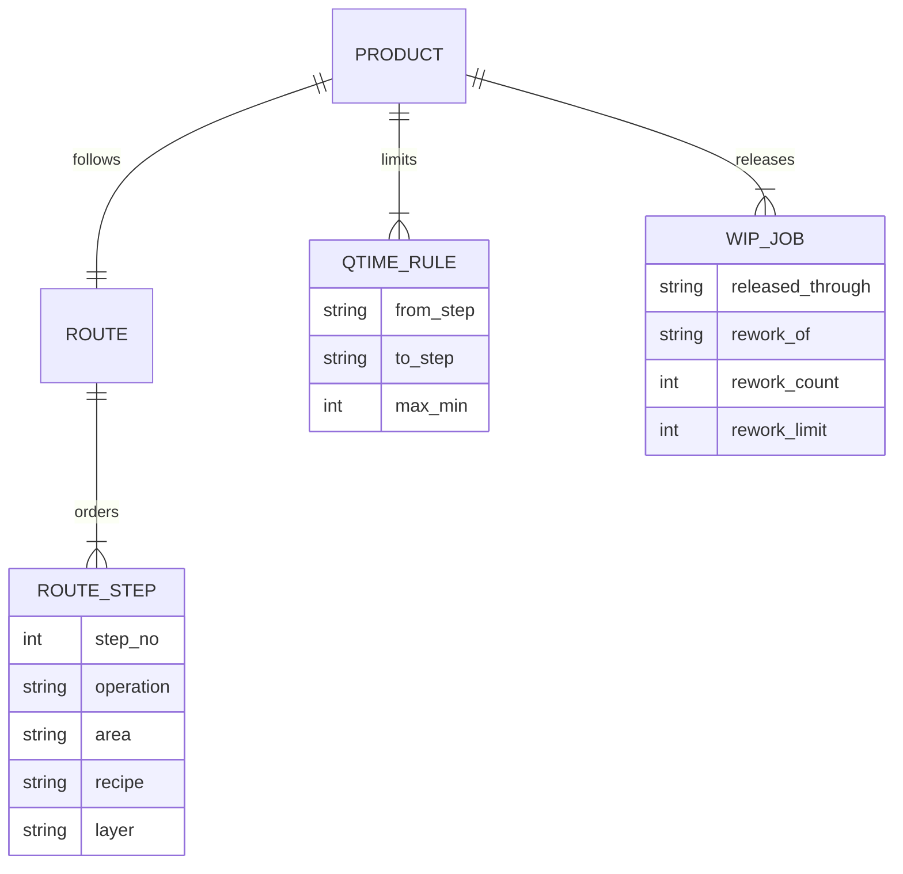

# Architecture

ResiliMES is a recovery loop for a shift supervisor. A disruption comes in. A signed contract comes out of Scout. Five Markovian chunks then sense the plant, schedule it, critique the schedule, explain it, and commit the assignments to an event log. The console renders the before and after.

## Clocks

The plant has a frozen scenario clock, default `2026-10-22T06:30:00Z`, because the sample WIP was generated at that moment. KPI math uses minutes from that clock.

Scout contracts use the wall clock. A contract TTL of five minutes is the public Scout default. Using the scenario clock would make every contract look expired on the day of the demo.

## Data

`Plant` is the in-memory snapshot: equipment, jobs, routes, queue-time rules, stock, operators, maintenance. Two sources build the same object.

A product follows one route. A route is an ordered list of operations. The same area can return on a later layer. PROD-A28 is lithography, etch, CMP on layer L1, then the same three areas again on L2. A lot released only through CMP is scheduled through the first CMP and does not enter L2 today. That is a release limit, not a second route.

A queue-time rule says the start of `to_step` must be within `max_min` of the end of `from_step`. The sample uses etch to CMP, which is the handoff this bay actually runs. The same shape covers a clean-to-furnace limit. There is no furnace in this six-tool bay, so the seed does not invent one.

The sample limit is 1100 minutes. Waiting out the scanner repair still places every lot, and LOT-1003, whose etch finished before 06:30, sits past 80 percent of that limit. The queue-time scenario tightens the B14 rule to 15 minutes. The Zetaris tables are `route`, `route_steps`, and `qtime_rule`, plus release and rework columns on `wip_jobs`. `data/sql/seed.sql` is generated from `data/sample`.

- `SampleSource` reads `data/sample` and records the SQL that Zetaris would have run.
- `ZetarisSource` runs that SQL through `agent.tools_zetaris.run_sql` and folds the rows with `plant_from_rows`.

The schema name is checked against `^[A-Za-z_][A-Za-z0-9_]*$` before it is interpolated. Statements are single `SELECT`s. `scripts/load_zetaris.py` is the only writer, and it only runs when someone passes `--execute`.

## Schedule

`schedule_plant` is a list scheduler.

1. Expand each lot's remaining route. An in-progress step keeps its remaining minutes. A step that already finished is skipped and opens a queue-time window if a rule names it. The sample's LOT-1003 has finished etch by 06:30, so only CMP remains. A rework flag inserts strip, then one re-expose, after the failed lithography step, and stops when `rework_count` has reached `rework_limit`.
2. Pin lots that are running on an up tool. They are not preempted.
3. Name the bottleneck: the area with the most remaining process minutes per up-tool minute over one day. A down tool adds no minutes. Ties break by area name.
4. Dispatch by priority, then due time, then whether the step is in the bottleneck or feeds it, then ready time, then lot id.
5. For each step, pick the qualified tool that minimizes estimated priority-weighted tardiness, then finish time, then setup. If the queue-time window is open and every feasible start misses it, the lot is held and the reason starts with `Q-time`. The book does not place a violating operation.
6. Charge setup only when the setup family changes. The family on a tool at the horizon is unknown, so the first lot on a tool pays no setup.
7. A tool runs one lot at a time. Operator demand across overlapping operations cannot exceed the pool. Material is consumed when a not-yet-started lot is dispatched. Short material holds the lot instead of driving stock negative.

`frozen` keeps the current assignment of the current step, which is how "wait for repair" is modeled: LOT-1001 stays on LITHO-02 until `available_at_min`. `recover` may move blocked and queued lots to any qualified tool.

## Critic

`critique_schedule` re-checks the committed schedule: calendar, capability, overlap, simultaneous WIP, operators, material, precedence, preemption, and queue time. A placed pair whose gap exceeds the rule is a high violation. A held lot is not a queue-time failure; the hold is how the book keeps the rule. High violations reject. Holds without a hard violation are conditional. The naive alternative (start on a down tool, preempt a running lot, expedite without resist, or start CMP after the etch window) goes through `critique_actions` and is what the console shows as rejected.

When a recovery assigns or moves a lot onto the bottleneck area, the action reason says so, and the brief adds one sentence to its last point. Dispatch already prefers that area, and the step that feeds it, ahead of other work at the same priority and due time.

The model is not on this path. A Nightshift outage cannot authorize a bad move.

## Engines

They compose the way the Meterless spec describes: Scout signs, Markovian runs the chain, World Model stores the result.

### Scout Intent

`resilimes/engines/scout/engine.py` implements Sense → Interpret → Guard → Route → Recommend.

- Sense is a deterministic trigger scan plus example overlap. An example phrase contained in the prompt, with a trigger hit, scores at least 0.92. The median classify call in `tests/test_scout_engine.py` stays under 16 ms.
- Interpret binds equipment ids (`Litho-02` → `LITHO-02`), repair durations, material ids, and product ids.
- Guard blocks prompt injection, a role outside the intent, and a surface outside the intent. A block decision has no contract.
- Route expands capabilities to a tool plan. Recovery intents include `world.query`, `world.sync`, `schedule.recover`, `schedule.commit`, and `memory.write`. Read-only intents include only `world.query`.
- Recommend picks a local model profile cleared for plant data. Mock mode selects `mock-deterministic`. Live mode selects the Nightshift Nemotron planner profile. The contract is HMAC-SHA256 over canonical JSON, TTL five minutes, `signedBy: scout`.

`replan` issues a new contract with `parentId` set and the same `traceId`.

High-risk `plant.emergency_stop` is signed only so downstream code can refuse it. World Model and Markovian reject a high-risk contract with an empty approval list.

### World Model

An append-only log. Event ids are a hash of type, entity, payload, and idempotency key, so a replayed ingest is a no-op. `replay()` folds the log into entities. Every ingest and query verifies the contract and the required capability.

### Markovian

`compress` keeps decisions, entities, open issues, and structured state. It drops `transcript`, `messages`, `raw_prompt`, `prose`, and `history`. A step that raises is recorded and the checkpoint stays at the last good state, so the next chunk still runs. The run reports checkpoint tokens next to the quadratic cost of resending the whole history. On the litho scenario the five chunks use about 500 checkpoint tokens against about 1600 for the naive history.

## Agents and the model

The orchestrator closes the loop in `resilimes/agents/orchestrator.py`.

The explainer calls `LlmProvider.complete` once per recovery. In mock mode that provider returns the deterministic narrative and labels the call `mocked: true`. In live mode the same call goes to Nightshift with `meterless-app: resilimes` and `meterless-scope: user`, model `NEMOTRON_MODEL`, with retries on 429 and connection errors. If the model returns something that is not a narrative, the deterministic text is kept. The committed schedule does not change either way.

## Console

FastAPI serves `/` and `/api/*`. The page is static HTML, CSS, and JS with no build step and no external font or script host, so `make demo` works offline. `POST /api/recover/stream` emits each real step (alert, Scout, contract, Zetaris read, sense, plan, critique, explain, commit) as server-sent events while `run_recovery` is still running, then the same report as `POST /api/recover`. Mock mode inserts a 680 ms gap between those events so the console can be filmed. The gap is delivery pacing; `elapsed_ms` on each event is the compute time. `pace_ms: 0` skips it. Live mode does not pace.

The Recover tab is the filmed frame: one headline, the critic's refusal, three numbers (on-time delivery, weighted tardiness, lots at risk), a slim loop stepper, and the before/after Gantt. Analyze holds the rest of the board, including a queue-time card (compliance, violations, at-risk) and the bottleneck card. Verify lists each constraint check as pass, fail, or refused, including queue time. The Gantt uses one time scale for both charts. Down time is the hatched band. A bar outline marks a lot whose tool changed. A rework bar adds a diagonal stripe on top of the area color. The bottleneck area has a mark on the tool label. A dashed tick marks a priority-1 due. KPI color comes from `tones` on the report: up or down only when the two books are comparable, otherwise flat. A stockout that holds lots out of the after book keeps makespan, lead time, X-factor, and changeovers flat. Durations on screen are hours and days; the API still speaks minutes.

## Failure behavior

| Failure | What the operator sees |
| --- | --- |
| Missing live credentials with `RESILIMES_MODE=live` | The request fails with the variable names. Mock mode never hits this. |
| Zetaris HTTP error | 503 with the status, body truncated, token not included. |
| Nightshift 429 | Three attempts, then the recovery fails. The schedule is not invented by a fallback model. |
| Prompt injection or wrong role | 200 with `blocked: true` and no Gantt. The refusal is the result. |
| Unsigned or expired contract | The engine raises. The API returns 409. |

Logs are JSON. A redactor strips values that follow `authorization`, `token`, `secret`, `password`, or `api key`.
