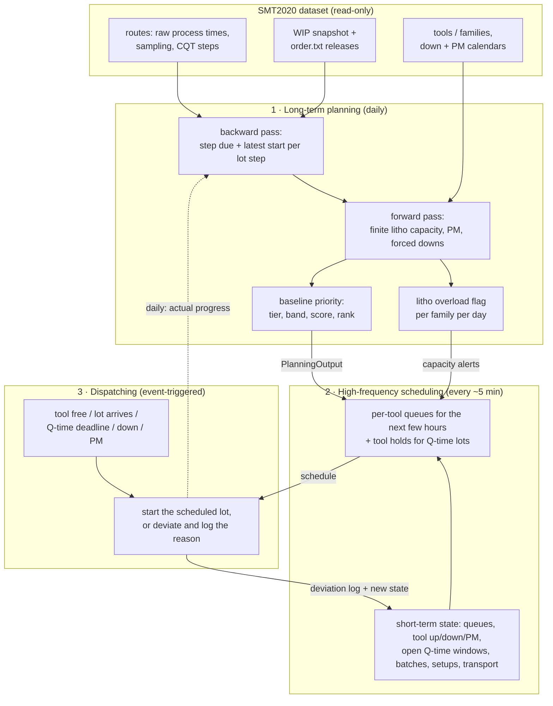

# Architecture layers: planning, priority, scheduling, dispatching

This page sets out how ResiliMES decides which lot runs where and when. It has
three time layers and one shared artefact, the **baseline priority**. Each
layer runs at its own cadence, reads what the slower layer produced, and adds
what only it can see:

1. **Long-term planning** (daily). Gives every lot step dues and a baseline
   priority from the order book and fab capacity.
2. **High-frequency scheduling** (about every 5 min of sim time). Combines the
   baseline with the short-term fab state and produces per-tool queues for the
   next few hours.
3. **Dispatching** (real time, event-triggered). Follows the schedule when a
   tool frees or a lot arrives. Every deviation is logged with a reason.

Everything below is derived from the SMT2020 data (process times, transport
rule, tool counts, down and PM calendars, order book). No layer uses a
hand-tuned weight.



## 1. Long-term planning

| | |
|---|---|
| **Cadence** | Once per sim day (and on demand per scenario). Full fab: about 2.5 s including about 3,200 dataset releases, or 0.6 s for WIP only. |
| **Inputs** | Each lot's route, current step, ready time, due and class (sim state or the published snapshot). SMT2020 raw process times and the sampled-metrology rule (`measured`). Fixed transport (1 min within an STNGRP, 3 min across). Litho tool counts. PM calendars (`pm`, `attach`). Down calendar (MTTF/MTTR). Forced downs. `order.txt` releases. |
| **Outputs** | `PlanningOutput`, described below. |
| **Code today** | `resilimes/smt/planning.py` (`plan_input`, `build_plan`, `plan_scenario`). It replaces the naive `kernel/aps.py` `backward_dues` and `simulate.macro_aps_ms`. |

**Method**

1. **Visit path.** The visit path is the current step plus every later step
   that this lot number is measured at. Skipped sampled metrology is skipped
   here as well, exactly as in the sim.
2. **Backward pass.** This pass starts from the lot due and works backwards
   over the remaining path, using raw process time and fixed transport. It
   gives each step a *step due* (latest finish) and a *latest start*. There is
   no queueing slack and no weight.
3. **Forward capacity check.** The check is an event-driven forward pass over
   every lot from its ready time:
   - Non-litho steps take raw time, so capacity there is unlimited.
   - Each `Litho_*` family (the 7 scanner families plus the 2 `Litho_Met`
     registration families) has a finite number of tools.
   - Queue order at each litho family is class tier, then latest start.
   - Processing time is raw ÷ availability. Availability is
     MTTF/(MTTF+MTTR) from the down calendar (0.9346 for scanners, 0.9965
     for registration).
   - A start that would overlap a PM window waits for the PM to end. This is
     the same no-overlap rule the sim uses.
   - A forced down removes that tool until it returns.
   - Lots that arrive at the same instant are started in priority order.

   Dataset releases up to the latest WIP due are planned as competing litho
   load.
4. **Baseline priority.** Three quantities feed the priority:
   - `raw_slack` = due − (ready + remaining raw time)
   - `plan_slack` = due − capacity-feasible finish
   - `score` = `plan_slack` / remaining raw time

   The score is dimensionless: it is the slack as a fraction of the work
   still to do.

   | band | rule |
   |---|---|
   | `critical` | `raw_slack < 0`: late even with zero queueing |
   | `behind` | `score < 0`: late once the litho capacity is accounted for |
   | `on_plan` | `0 ≤ score < 1` |
   | `ahead` | `score ≥ 1`: more slack than the remaining work itself |

   The rank sorts on (class tier, band, score, due). VIP comes before hot,
   which comes before normal, as the published HotLotFIRST rule does. Within
   a tier, the most urgent band and the lowest score come first.
5. **Q-time.** Q-time applies only to steps that have a dataset CQT. The plan
   counts each lot's CQT windows on the path, including windows the lot is
   already inside, which are inherited. It also flags the windows the plan
   itself breaks.
6. **Litho overload.** Each litho family gets one row per day with three
   figures:
   - *capacity*: tool up-hours, outside PM and forced downs, × availability
   - *demand*: raw litho hours whose latest start falls that day (backlog
     counts on day 0)
   - *planned*: hours the forward pass starts that day

   `overload` means demand > capacity on that day. `cum_overload` means
   cumulative demand > cumulative capacity up to that day.

**Out of scope for this layer.** The scheduling layer handles these:
setups, batching, dedication, rework, and capacity outside litho.

### `PlanningOutput` (what the scheduling layer consumes)

```python
plan = plan_scenario(load_fab(), "published")          # or build_plan(fab, plan_input(fab, now=..., lot_step=..., ...))
plan.lot("Init_Lot_1_8").band                          # 'on_plan'
plan.priority_key("Init_Lot_1_8")                      # (rank,) – sort key, lower first
plan.step_due("Init_Lot_1_8", route_step)              # step due (s) for a visited step
plan.band_counts()                                     # WIP lots per band
plan.overloads()                                       # LithoDay rows with overload=True
plan.summary(); plan.to_dict(limit=20)                 # JSON-ready
```

`LotPlan` carries the following per lot:

| Group | Fields |
|---|---|
| Identity | `lot_id`, `route_id`, `order_class`, `tier`, `released` |
| Times | `ready_sec`, `due_sec` |
| Remaining work | `remaining_raw_sec` |
| Finishes | `raw_finish_sec`, `plan_finish_sec` |
| Slack | `raw_slack_sec`, `plan_slack_sec`, `litho_wait_sec` |
| Priority | `score`, `band`, `rank` |
| Q-time | `qtime_windows`, `qtime_at_risk` |

It also carries these per-step tuples, aligned on `steps`: `step_due`,
`latest_start`, `plan_start`, `plan_end`.

## 2. Baseline priority (the shared artefact)

The priority is not a separate process. It is the planning output that the
two faster layers read:

- **Scheduling** uses `rank` as the default queue order. It also uses `band`
  to decide which lots may claim scarce tools such as Q-time holds and
  batch-forming waits.
- **Dispatching** uses `rank` as the tie-break once the hard constraints are
  met: Q-time urgency, a ready batch, setup, eligibility. It uses
  `step_due[next step]` to say how late a deviation makes a lot.

A lot moves to another band only when the plan reruns (daily), so the band is
stable. The scheduling layer works out short-term urgency from live state.

## 3. High-frequency scheduling

| | |
|---|---|
| **Cadence** | Every `REPLAN_SEC` = 300 s of sim time (the qtime-r2 tick) |
| **Inputs** | `PlanningOutput`. Live queues per family. Tool state: up, down, PM, setup recipe. Open Q-time windows and their deadlines. Batch candidates. Inbound lots with arrival times. Live wait estimates per family. |
| **Outputs** | An ordered queue per tool for the next few hours, holds for Q-time lots, batch-forming decisions, and stall counts. |
| **Code today** | `simulate._Sim.tick` (qtime-r2, PR #21) does four things: refreshes the live wait estimates (`refresh_estimates`), sets the Q-time hold plan (`plan_holds`), counts stalls, and snapshots queue order. It does not read a baseline yet. |
| **Target** | `tick` reads `PlanningOutput.rank`/`band`, projects each tool's queue over the next 2–4 h, and writes a `Schedule` with tool → [lot, planned start, reason]. |

## 4. Dispatching

| | |
|---|---|
| **Cadence** | Event-triggered: a tool frees, a lot arrives, a Q-time deadline falls, a down or PM starts or ends |
| **Inputs** | The latest schedule and the live state at the event |
| **Outputs** | A lot start (tool, lot, time). When the started lot is not the scheduled head, a deviation record with a reason. |
| **Code today** | `simulate._Sim` dispatch with `rank`/`cheap`/`plain_rank` (policies `resilimes`, `edd`, `cr`, `fifo`, `smt_rule`). Q-time-urgent override, shortlist, reservation (qtime-r2). Lot and tool states and hold reasons are in `resilimes/smt/fsm.py` (PR #20). |
| **Target** | Dispatch takes the schedule head unless a hard rule overrides it. Each override logs `(time, tool, scheduled_lot, started_lot, reason)`, where the reason is one of `qtime_urgent`, `batch_ready`, `setup`, `not_arrived`, `ineligible`, `tool_down`, `pm`, `hold` or `schedule_stale`. |

## Current versus target code map

| Layer | Today | Target |
|---|---|---|
| Planning | `smt/planning.py` (new). `kernel/aps.py` and `simulate.macro_aps_ms` are naive and superseded. | `planning.py` called once per sim day from the sim, using live lot state |
| Priority | `kernel/score.py` `class_tier` and `tiered_key`. Live slack inside the sim. | `PlanningOutput.rank`/`band` with the live risk from qtime-r2 on top |
| Scheduling | `_Sim.tick` (300 s): wait estimates, Q-time hold plan, stall counter | Per-tool queue for the next few hours, seeded by rank |
| Dispatching | `_Sim` rank keys, Q-time override, reservation | Follow the schedule head and log every deviation with a reason |

**Known gap.** The sim does not release `order.txt` lots yet. Only the 2,156
WIP lots flow. The plan already includes the releases, so planned litho load
is higher than the sim's load. When the sim releases lots, it should use
`planning.dataset_releases`, the same parser.

## Integration plan (after PR #21 lands)

**Simplified version, by Monday 2026-10-26 evening JST**

1. Rebase onto `main` once #21 is merged. `planning.py` touches no existing
   file, so no conflict is expected.
2. In `run_policy`, add `plan: PlanningOutput | None = None`. This is an
   opt-in parameter; the default changes nothing. Call `plan_scenario` once
   before the run (2.5 s).
3. Scheduling: in `tick`, when `plan` is set, order each family's live queue
   by `(urgency_band, plan.rank)` and store the head *k* per tool as
   `scheduled[tool]`. *k* is the tool's lots in the next `REPLAN_SEC`.
4. Dispatching: when a tool starts a lot that is not `scheduled[tool][0]`,
   append `("deviation", t, tool, scheduled, started, reason)` to `events`.
   The reason comes from the branch that made the choice: Q-time override,
   batch, setup, reservation, or a scheduled lot that has not arrived.
5. Report the following per scenario: deviation counts by reason, plan-band
   versus actual-lateness confusion, and on-time rate for `resilimes`+plan
   versus `resilimes`.
6. Add tests for three things: the sim with `plan=None` is bit-identical to
   today; every deviation has a reason; and a plan-ordered queue starts the
   rank-1 lot first on a toy fab.

**Full version (after Monday)**

- Replan daily inside the sim. Feed `plan_input(fab, now=t, lot_step=…,
  lot_ready=…, finished=…, down_until=…)` from live state and swap the plan at
  the day boundary.
- Release `order.txt` lots in the sim (`dataset_releases`).
- Scheduling projects a 2–4 h per-tool queue that covers batching, setup
  sequences and PM. The UI shows schedule versus actual.
- Feed capacity alerts back: an overload day pulls PM-flexible windows
  (`pm_avoid`) or changes litho tool dedication.
