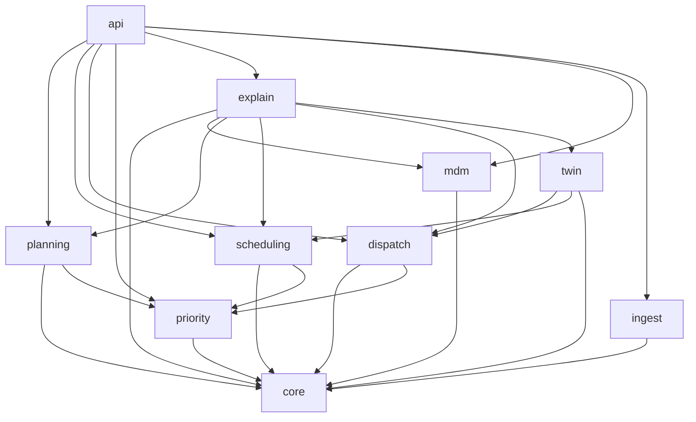
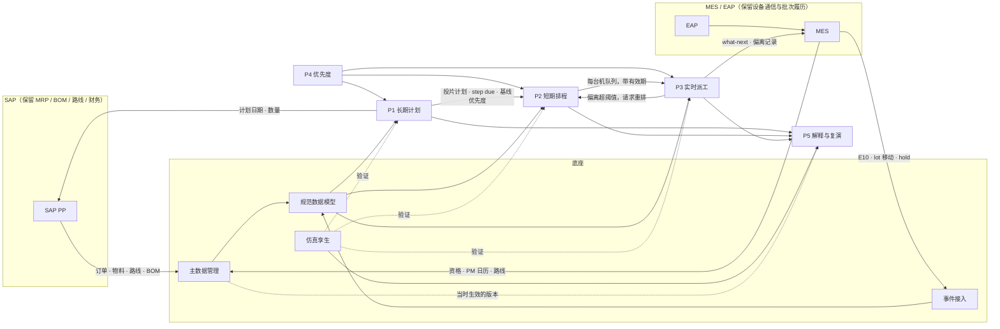
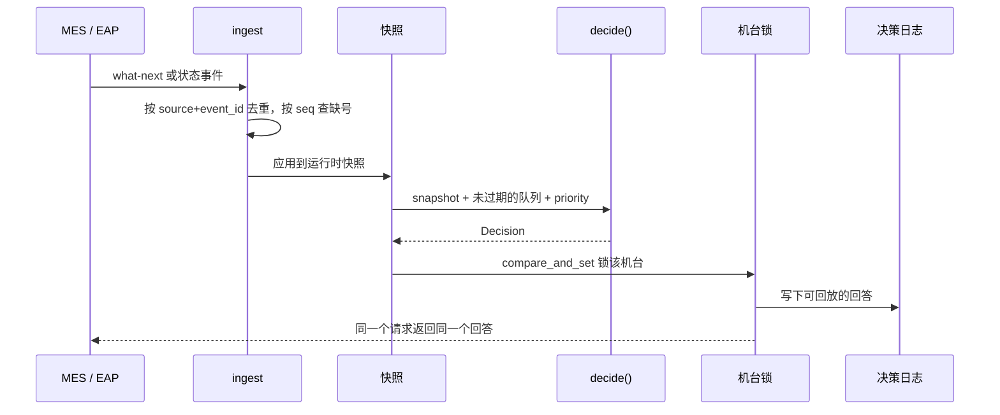

# 开发架构报告

本文说明 ResiliMES-AI 从现在的比赛 demo，演进到「五个产品加一个底座」时，代码怎么拆、数据怎么流、先改哪一块。产品边界和投放顺序以 [PRODUCT_ARCHITECTURE.md](PRODUCT_ARCHITECTURE.md) 为准。本文写开发侧的决定：包怎么分、两套排程怎么桥、主数据怎么管、接口和存储怎么选。

本文是计划，不是现状说明。现状以代码和 [ARCHITECTURE_LAYERS.md](ARCHITECTURE_LAYERS.md)、[HARD_QTIME.md](HARD_QTIME.md)、[API.md](API.md) 为准。文中引用的数字都来自仓库现有文档，没有为本文重跑。

## 1. 仓库里现在有什么

这些是核对过代码的事实：

- 后端是 FastAPI（`resilimes/api/app.py`），前端是原生 JS，没有构建步骤，入口在 `resilimes/demo/static/app.js`（3,533 行）。没有 Next.js。
- 仿真和排程主路径在 `resilimes/smt/`。`simulate.py` 3,022 行，核心逻辑在 `_Sim`（tick、build_schedule、派工、偏离记录）里，还没有抽成纯函数。
- 另外一套在 `resilimes/domain/`：list scheduler（`schedule.py`）加 CP-SAT（`cpsat.py`），模型和检查用 pydantic（`models.py`），主要服务样例车间和 Scale 场景。
- 还有一套更早的三阶段内核在 `resilimes/kernel/`（`aps.py`、`erp.py`、`dispatch.py`、`score.py`）。[ARCHITECTURE_LAYERS.md](ARCHITECTURE_LAYERS.md) 已标明 `kernel/aps.py` 被 `smt/planning.py` 取代，不再作为 P1 的基础。
- Redis 只在 `txn/store.py` 里做 KV 锁（`compare_and_set`）。没有 Redis Stream，也没有对外的 webhook。`REDIS_URL` 为空时用进程内的 `InMemoryStateStore`。
- 事件现在只存在仿真内部的 `events` 列表里，类型包括 `qhold`、`reserve`、`release`、`end`、`rework`、`reclean`、`interrupt`、`skip`、`replan`、`deviation`、`tick_stall`。没有独立的接入层。
- 测试 632 个。`tests/conftest.py` 把 `RESILIMES_SCHED_MODE` 默认钉在 `strict_qtime`，而产品默认模式是 `plan`。`tests/test_sched_mode.py` 覆盖了默认模式，但默认路径的 KPI 回归还不完整。
- 部署是单进程：`python -m resilimes serve`，Dockerfile 暴露 8000 端口。`docker-compose.yml` 只起 Redis 7。CI（`.github/workflows/ci.yml`）在 Python 3.11 和 3.12 上跑 lint、mypy、pytest 和离线 smoke。
- 日志是 JSON，带密钥脱敏（`logging_config.py`）。API 没有独立的用户认证层；Scout 对 intent 做签名和 TTL，确认路径用机台锁。

默认调度模式、71 次可避免 Q-time 违规、解释器只有 3 个手段且复演通过 1/12、AI 值班长默认调用 0 次，这些以 README 和 HARD_QTIME.md 为准，本文不重复展开。

## 2. 模块化单体：包怎么分

先做模块化单体，不拆服务。将来只有 P3 因为可用性要求，可以单独部署；在那之前，仿真和将来的服务调用同一套 `decide()`。

目标包结构（在现有 `resilimes/` 下逐步长出来，一次搬一个模块，旧路径留转发）：

```
resilimes/
  core/        规范数据模型、ID、外部 ID、版本号、适配器（SMT2020、样例车间）
  mdm/         主数据：同步、校验、按生效时间取版本（读 SAP/MES，写入 core）
  twin/        仿真（从 smt/ 逐步迁入，先不改 simulate.py 内部）
  priority/    P4：priority(lot, now) -> (band, rank, 构成)
  planning/    P1：投片、step due、产能与交期检查
  scheduling/  P2：每台机队列、冻结区、Q-time 门控
  dispatch/    P3 的 decide()（纯函数，无 I/O）
  explain/     P5 的归因和解释（insight/、evidence/ 迁入）
  ingest/      事件契约、去重、回放
  api/         HTTP 接口（现有路由保留，按资源往外加）
  demo/        静态控制台（不重写）
```

短期内 `smt/`、`domain/`、`kernel/`、`insight/`、`evidence/` 都还在。`kernel/` 标为废弃，不再扩展。`engines/`（Scout、Markovian、World Model）和 `agents/` 继续服务现有控制台的恢复回路，不并进五个产品的主路径；产品路径用规则排程和解释，不经过这条 agent 链。

依赖方向：



规则：

- `core` 不依赖任何人。
- `mdm` 只依赖 `core`。产品模块读的是已经按生效时间展开的主数据快照，不直接解析 SAP/MES 的原始表。
- `priority` 只依赖 `core`。
- `planning`、`scheduling`、`dispatch` 依赖 `core` 和 `priority`。
- `explain` 可以读所有层，复演时向 `mdm` 取当时的版本，但不被规划、排程、派工依赖。
- `twin` 调 `dispatch` 和 `scheduling` 的同一套函数，这样仿真结果才能直接验证 P3/P2。
- 用 import-linter 一类工具在 CI 里检查，现在还没有这道检查。

搬迁验收：默认模式、固定种子下的完成数、准时率、可避免 Q-time 违规，必须和搬迁前一致。测试和 `study_*` 脚本不要求一次改完。

## 3. 两套排程栈怎么桥

现在是两套，不是一套的两个前端。

| | SMT 栈（`smt/`） | domain 栈（`domain/`） |
|---|---|---|
| 规模 | SMT2020：文档中的默认控制台是 1,313 台设备、2,156 个 lot | 样例车间几台到几十台；Scale 场景 1,000 lot / 36 台 |
| 算法 | 计划层 + tick（默认 300 秒仿真时间）+ 派工规则 + hard Q-time + 可选冻结区 | list scheduler；CP-SAT 做同一目标的对照 |
| 模型 | `smt/fab.py` 的 `Fab` | `domain/models.py` 的 `Plant` |
| 谁在用 | 默认控制台、研究和 KPI 数字 | 样例车间、批评器和一部分 API |

不把两套合成一个仿真器，也不再并行发展两套产品级启发式。

做法：

1. 新建 `core` 模型，两套各写一个适配器单向转入。先不改 `simulate.py` 内部。
2. 产品级的 P2/P3 以 SMT 栈为运行基础。`domain/` 的 CP-SAT 留下，作为小窗口的最优参考，给 P2 的启发式打分（同一个目标函数，同一份 core 快照），不作为全厂排程器。
3. `kernel/dispatch.py` 的 `choose()` 已经是无 I/O 的决策函数，但规则和 SMT 栈不一致，不能直接当 P3 的 `decide()`。P3 从 `_Sim` 往外抽，抽完之后 `kernel/dispatch.py` 只留作废弃路径的测试对照。
4. `schedule_plant` 仍可服务现有控制台的恢复回路和样例车间，直到这条回路不再需要它。它不是 P2 的目标实现。

桥接的验收标准是：同一份 core 快照，SMT 适配器跑出来的资格、标准工时、Q-time 窗口、PM 时段，和直接读 `Fab` 一致；CP-SAT 只在抽出来的小窗口上跑，不要求吃下全厂 SMT2020。

## 4. 主数据管理与数据模型

主数据放在底座，不是第六个对外产品。五个产品都从这里读准静态数据。运行时状态（E10、WIP、在制、事件）不归主数据管，由事件接入写入 core 的运行时快照。

真正的源头多半在 SAP 和 MES。这个模块负责同步、校验、补齐和按生效时间留版本，不是另建一套从头录入。排程前先跑校验，例如「计划用了这台机，但资格已经过期」。

### 4.1 主要实体

下面是逻辑实体，不是已经建好的数据库表。字段定稿和规范数据模型一起做。每个对象都带内部 ID、外部 ID（SAP 或 MES 的编号）、来源、版本号、生效起止时间。

| 实体 | 主要内容 | 现在散落在 |
|---|---|---|
| 机台 / 腔体 / 端口 | 机群、能力、腔体 | `domain` 的 `Equipment`；`smt` 的 `Family` / tool；`smt_tool` |
| 机台能力 | 机台（或腔体）× recipe × 工步：能否做、加工时间、batch 上下限 | `RouteStep.process_time_min`；`planning.standard_time`；`operations`（`kernel.sql`） |
| 资格 / 专用 | qualification、dedication；哪类 lot 或产品只能走哪台 | `Inhibit`；`Route.dedicate_root`（SMT2020 里声明了，但注释写明没有做到 scanner 级资格） |
| 班次日历 | 班次、可用工时 | 样例有 `Operator.shift`；SMT 栈没有独立的班次实体 |
| PM / 计划停机 | 窗口、时长、类型 | `MaintenanceEvent`；`smt` 的 `pm`、`pm_calendar`、`smt_pmcal`、`smt_attach`、`pm_calendar`（`kernel.sql`） |
| 可靠度统计 | MTBF / MTTR，排程时扣产能用 | `Equipment.mtbf_hours`；`smt` 的 `down_mttf` / `down_mttr`、`smt_downcal` |
| 换型矩阵 | 从哪个 recipe 换到哪个、耗时 | `setup_family`；`smt.setup`；`setup_matrix`（`kernel.sql`）；`smt_setup` / `smt_setupgrp` |
| 产品 / 路线 / 工步 | 顺序、recipe、抽检 | `Product`、`RouteStep`；`smt.Route`；`smt_part`、`smt_route` |
| Q-time 约束 | 起止工步、上限、是否可补救 | `QTimeRule`；route 上的 `cqt_limit` / `cqt_target` |
| 物料 / BOM | 和 SAP 物料、BOM 的对应 | `MaterialNeed`、`MaterialStock`、`bom.json` |
| 光罩 / 抑制 | 光罩副本、禁止某机做某 recipe | `Reticle`、`Inhibit` |
| 产品与 lot 的静态属性 | 交期口径、初始优先度、SAP 物料对应 | `Job` / `smt` 的 lot 字段；`orders`、`lots`（`kernel.sql`） |
| 版本与审计 | 谁改的、何时生效、来源、原因 | 没有 |
| 数据问题 | 校验结果：对象、严重度、影响、状态 | 没有 |

lot 的动态属性（当前工步、hold、所在机台）属于运行时，不属于主数据。P4 的人工覆盖是优先度记录，也不写入主数据版本。

### 4.2 版本怎么用

- 每次同步或人工补齐都生成新版本，旧版本不删，只把 `effective_to` 收口。
- 排程和派工读「当前生效」的快照。
- P5 复演按事件发生的时间取当时生效的版本。缺版本就标明数据缺口，不用今天的数据去解释昨天的结果。
- 生效时间允许预先录入（例如下周一开始的新资格），不靠发布瞬间切换。

### 4.3 同步与校验

同步是单向为主：SAP / MES → 主数据。回写 SAP 只发生在 P1 明确要改计划订单的日期和数量时，走 P1 的接口，不经过主数据的日常同步。

先支持的来源：

1. 现有文件和 SQL 种子（SMT2020、`data/sample`），用来把校验和版本跑通。
2. 手工导入或补齐（缺边、缺资格、缺工时）。
3. SAP PP 和 MES 的同步样例。接口方式按客户的 SAP 版本选（BAPI、IDoc 或 S/4HANA 的 OData），这里不预设；MES 侧先按文件或 HTTP 批次拉取资格、PM 日历和路线。

排程前必跑的校验（先在 SMT2020 和样例车间上实施，不需要先有 SAP）：

- 路线工步找不到能做的机台，或计划用的机台没有资格。
- Q-time 的起止工步在路线里对不上。
- 换型矩阵缺边（从 A 到 B 没有时间）。
- 加工时间为空或为零，但路线包含该工步。
- PM 日历和 MES 计划停机冲突，或窗口重叠但来源不一致。
- SAP 路线或物料版本比本地新，尚未同步。

有高优先级问题时应阻止把该机台或该路线纳入承诺区；预测区可以继续算，但要在报表里标出来。

## 5. 事件契约与接入

现在没有接入层。先定契约，再选传输。传输可插拔：先用文件或 HTTP 回放仿真里已有的 `events`，有真实 MES 时再接消息队列。不预设 Redis Stream。

每条事件至少带：

| 字段 | 含义 |
|---|---|
| `source` | 来源（mes、eap、twin、manual） |
| `event_id` | 来源侧的稳定 ID |
| `seq` | 来源侧序号，用来发现缺号 |
| `occurred_at` | 现场发生时间 |
| `received_at` | 本系统收到时间 |
| `type` | 事件类型 |
| `payload` | 类型对应的字段 |

按 `(source, event_id)` 去重，按 `seq` 检测缺失。同一条事件重放是空操作。

第一批类型只覆盖派工需要的：设备状态变化（E10 语义：生产、待机、工程、计划停机、非计划停机、非排定）、lot 进出站、lot hold/release、Q-time 窗口开始、PM 开始结束。仿真内部已有的 `deviation`、`replan`、`reserve` 是本系统自己产生的记录，写入决策日志，不混进 MES 事件流。

SECS/GEM 不由本系统直接处理。设备通信是 EAP/MES 的事，这里只消费 MES/EAP 给出的事件。E30/E40/E87/E90/E94 只作为字段语义的参考。

SAP PP 的同步（计划订单、生产订单、BOM、路线、物料可用量）走主数据或 P1 的批次接口，不走这条实时事件流。

## 6. 仿真孪生的角色

现有 `smt/simulate.py` 和 `smt/twin.py` 已经能跑 SMT2020，并按种子分叉未来（AI 值班长和解释器的复演都用它）。在新架构里它有三个用途，都不变：

1. P1/P2/P3 的离线验证：同一套 `scheduling` / `decide()` 在孪生里跑，KPI 才有对照。
2. P5 的方案复演：改杠杆之前先分叉，通过才展示。
3. 没有真实 MES 时充当事件源：孪生打出来的事件用同一套契约回放，作为 ingest 的第一个实现。

注意：`twin.py` 现在主要服务于值班长的杠杆分叉，还不是通用的「任意历史时刻 + 任意主数据版本」复演器。P5 要用后一种，需要在孪生上补「按时间加载主数据版本 + 按事件重建状态」的入口。这是中期的工作，不是现在就已经有的能力。

`simulate.py` 单文件过大。拆文件可以跟抽 `decide()` 一起做，但拆文件本身不是产品功能，不能破坏固定种子的 KPI。

## 7. 产品之间的接口和数据流



各层约定（与产品架构文档一致，这里只补开发含义）：

- 慢层的输出是快层的目标和约束。P2 只对冻结区承诺（现在 `freeze.py` 默认 2 个 load 或 30 分钟，而且默认是关的）；冻结区外是预测。
- P3 默认跟 P2 队首。偏离使用现有九个原因码：`qtime_urgent`、`batch_ready`、`setup`、`not_arrived`、`ineligible`、`tool_down`、`pm`、`hold`、`schedule_stale`。现在代码已经记录偏离，但派工还不优先跟队首（“measured, not followed”）。
- P2 的计划带有效期。过期或缺失时，P3 退回本地规则（Q-time、hold、资格、PM 冲突、优先度），照常回答。P3 不依赖 P2 才能工作。
- P4 提供 `priority(lot, now) -> (band, rank, 构成)`。人工覆盖要有原因、到期时间和操作人，到期自动失效，全流程可审计。现在 `kernel/score.py` 和 `planning.priority_key` 还是两处入口，没有覆盖，也没有审计。
- P1 先做产能可行性和交期检查，不先做完整 APS。回写 SAP PP 仅限计划订单的日期和数量。

## 8. P3 的 decide() 路径，以及延迟和可用性

目标接口：

```
decide(snapshot, schedule, priority) -> Decision
```

- `snapshot`：某时刻的机台状态、WIP、hold、打开的 Q-time 窗口、资格（来自当时生效的主数据）、PM。
- `schedule`：该机台的 P2 队列；可以是缺失或已过期，函数必须仍能返回。
- `priority`：P4 在 `now` 的结果（含未到期的人工覆盖）。
- `Decision`：选中的 lot 或组批、原因、是否跟随队首、偏离原因码、约束过滤清单。无 I/O，不读时钟，不写库。

调用路径：



从 `_Sim` 往外抽时，仿真改为调用这个函数，固定种子 KPI 必须不变。将来的 P3 服务也调它。`txn/` 现有的 compare-and-set 机台锁，是幂等和并发控制的起点，可以继续用；Redis 仍然只做这把锁，不当事件总线。

延迟和可用性：

- 端到端（MES 发出请求到收到回答）p99 < 1 s、可用性 ≥ 99.9%，都是初定，要按试点 MES 校准。
- 仓库里能引用的派工耗时（例如赞助技术文档里的仿真内 p95）只是端到端预算里很小的一段。真正的时间会花在「拿到一致的 WIP 和设备状态」上。因此 decide() 本身保持纯计算，快照必须在请求到达前维持好，而不是在请求里现查 MES。
- 幂等：同一 `request_id` 或同一 `(source, event_id)` 返回已记录的回答，不重算一个不同的结果。
- 可用性在单体阶段靠单进程 + 健康检查（已有 `GET /api/health`）和可重启的快照恢复（事件回放）。主备是 P3 单独部署时再做的事，现在做不了 99.9% 的跨机保证，这一点要说清楚。
- P2 故障时的回退已经在产品规则里：计划过期就走本地规则，不能停线。

## 9. API 与前端

现有 HTTP 入口（`resilimes/api/`）：

- 控制台和恢复回路：`/`、`POST /api/recover`、`POST /api/recover/stream`、`GET /api/scenarios`、`GET /api/sched/ticks`、`GET /api/health`、`GET /api/shift-lead/status`、`POST /api/providers/probe`
- Intent：`POST /api/intents`、`POST /api/intents/confirm`
- 厂况：`/api/fab/meta|overview|tools|flow|lot/{id}|batches|events|kpis`
- 解释和调查：`/api/ai/investigator/cases`、`/api/ai/investigate`、`/api/ai/explainer/lots`、`/api/ai/explain`、`/api/ai/notes`、`/api/ai/handover` 等

这些路由保留。新产品的接口按资源往外加，不另起一套网关。建议的新路由（都还没有）：

| 路径 | 用途 |
|---|---|
| `GET /api/mdm/tools`、`/capabilities`、`/calendar`、`/issues`、`/versions` | 主数据查询，支持 `as_of` |
| `POST /api/mdm/sync`、`POST /api/mdm/corrections` | 同步和人工补齐，写审计 |
| `GET /api/schedules`、`POST /api/schedules/replan` | P2 队列和重排 |
| `POST /api/dispatch/decide` | P3 what-next（内部调 `decide()`） |
| `GET /api/priority`、`POST /api/priority/overrides` | P4 查询与人工覆盖 |
| `GET /api/explain/...`、`POST /api/explain/replay` | P5 归因和复演（可逐步从 `/api/ai/*` 迁） |
| `GET /api/planning/capacity`、`POST /api/planning/commit` | P1 产能检查和回写样例 |

契约稳定之前，先写 OpenAPI（FastAPI 已能生成），用样例数据定字段，不先做前端重写。

前端维持原生 JS，不引入 Next.js 或新的构建链。API 稳定之后，先把甘特图和 why 面板从 `app.js` 里抽成可复用组件，再加主数据、报表和各产品画面。想定页面是设计参考，不是当前控制台的实现。

## 10. 存储

按用途分开，不把所有东西塞进一种库。

| 数据 | 现在 | 近期 | 以后 |
|---|---|---|---|
| 主数据与版本 | JSON / CSV / SQL 种子，进程内对象 | SQLite 或 Postgres（版本、生效时间、问题清单）。demo 用 SQLite 即可 | 试点用 Postgres |
| 运行时快照（WIP、E10） | `_Sim` 内存；样例车间的 `Plant` | 仍以内存为主，由事件回放重建 | P3 单独部署时，快照可落在本机或 Postgres |
| 事件与决策日志 | 仿真 `events` 列表；World Model 有一份样例车间的追加日志，产品路径没用它 | 文件或 SQLite，按契约可回放 | Postgres 或专用日志；传输层仍可插拔 |
| 机台锁 | 内存，或 Redis KV | 保持原样 | P3 多实例时用 Redis KV，仍不做 Stream |
| 计划与优先度覆盖 | 仿真内存 | 和决策日志一起落库 | 同上 |

不引入新的消息中间件，除非已经有真实 MES 并且文件/HTTP 回放不够用。Zetaris 继续作为可替换的查询来源，不是主存储，也不是卖点。

## 11. 测试与 KPI 基线

这是所有重构的前提，写在产品架构的近期工作第一条，这里只落实到工程步骤：

1. 测试在 `plan` 和 `strict_qtime` 两种模式下都跑。`conftest.py` 不再偷偷改掉默认模式；需要钉模式的测试自己声明。
2. 为默认模式加固定种子的 KPI 回归：完成数、准时率、可避免 Q-time 违规，对照 README / HARD_QTIME.md 里已公布的数字（计划 + hard Q-time，seeds 1–3，7 天：可避免违规合计 71，完成数 486.7 / 次，准时率 82.12%）。基线一旦录入，搬模块或抽函数都不能无说明地改这些数。
3. 主数据校验本身要有测试：用现有 SMT2020 和样例车间当输入，断言能产出问题清单；再准备几条故意造坏的数据（缺资格、Q-time 对不上）证明能抓到。
4. `decide()` 抽出来之后，用同一快照做单元测试，再用孪生跑回归，确认和抽之前逐位一致。
5. 现有 632 个测试全部保留。CI 矩阵（3.11 / 3.12）不变。

现在还没有这条默认模式 KPI 基线，所以近期第一项是补测试，不是开始搬家。

## 12. 部署与可观测性

现在就是一个 Python 进程加可选的 Redis。继续保持这种形态，直到有试点需要把 P3 拆出去。

- 开发：`make demo`（SMT2020，mock）、`make demo-bay`（样例车间）。
- 部署：现有 Dockerfile 即可跑单体。不要为五个产品各做一份镜像。
- P3 将来单独部署时，镜像里只放 `core`、`mdm` 只读快照、`priority`、`dispatch`、`ingest` 和精简 API，不带孪生和解释器。那是长期工作，现在不拆仓库。

可观测性在现有 JSON 日志上加字段，不先上新的平台：

- 决策：`request_id`、机台、选中 lot、是否跟随队首、原因码、decide() 耗时、端到端耗时。
- 接入：接收滞后（`received_at - occurred_at`）、缺号、重复。
- 主数据：同步次数、校验问题数（按严重度）、当前生效版本。
- 健康：已有 `/api/health`；以后加「快照新鲜度」和「P2 队列是否在有效期内」。

密钥、token、`.env` 继续走现有脱敏规则，日志里不得出现明文。

## 13. 安全与审计

现在已经有的：Scout 对 intent 签名和 TTL、确认前不改现场、机台锁、批评器拒绝则不提交、日志脱敏、`notify_pe` 只留痕迹不发信。这些保留，给的是现有控制台的恢复回路。

产品路径上要补的：

- 主数据每次改动：操作人、来源、原因、生效时间、前后版本。人工补齐和自动同步用同一套审计。
- P4 人工覆盖：原因、到期、操作人；到期自动失效；覆盖对队列的影响要能查到。
- P3 每个回答可回放：输入快照的版本（主数据版本 + 事件序号）、输出、是否跟随队首。
- 写接口（同步、覆盖、回写 SAP、确认派工）需要认证和角色。现在 API 还没有用户认证，试点前必须补上；采用什么方式（反向代理、会话，还是客户的 SSO）等试点再定，这里不预设。
- 本系统不直连设备，不保存 SECS/GEM 原始报文。

## 14. 分阶段路线（对齐现有代码）

### 近期（1–2 周）：打地基，不加产品功能

1. 双模式测试 + 默认模式 KPI 基线（见第 11 节）。入口：`tests/conftest.py`、`tests/test_sched_mode.py`，数字对照 HARD_QTIME.md。
2. 规范数据模型和主数据实体文档，先不迁代码。对 SMT2020 和 `data/sample` 跑校验，列出问题。入口：`domain/models.py`、`smt/fab.py`、`data/sql/kernel.sql`。
3. 把 P4 抽成 `priority` 模块，统一 `kernel/score.py` 和 `smt/planning.py` 的 `priority_key`，结果和现在逐位一致。
4. 从 `_Sim` 抽出 `decide()`，仿真改为调用它，KPI 不变。入口：`smt/simulate.py`，对照 `kernel/dispatch.py` 只作参考。
5. 定事件契约，用仿真 `events` 写回放器。入口：`simulate.py` 的 `events` 列表，以及 `/api/fab/events`。

完成标准：上面都有测试；默认模式 KPI 与现在一致；主数据校验能在现有数据集上给出问题清单。

### 中期（1–2 个月）：先做出 P5，并在孪生里验证 P2/P3

1. P5 结果级归因：只用批次履历、设备状态、PM 日历这类 MES 常见数据，在 SMT2020 上做延误和 Q-time 归因，不依赖我们自己的决策记录。入口：`insight/`、`evidence/`。
2. 解释手段从 3 个扩到 6–8 个，每个方案先在孪生里复演，通过才展示。入口：`insight/explainer.py`、`smt/twin.py`。复演要能指定主数据版本。
3. P2：按 HARD_QTIME.md 的分类继续消除 71 次可避免违规；队列投影从一个 tick 扩到 2–4 小时，先做光刻、炉管批次和 Q-time 链。入口：`build_schedule`、`hard_qtime.py`、`freeze.py`。
4. P3：默认跟随队首，偏离按九个原因码记录，在孪生里量化跟随率和对 KPI 的影响。
5. 主数据加上版本和生效时间，提供文件或手工导入；SAP/MES 自动同步只做样例。
6. 3–5 次计划或 IE 人员访谈，找一个能提供半真实数据的试点。

完成标准：P5 能用「只有 MES 数据」的输入在 SMT2020 上跑通；主数据能按时间取版本；有访谈记录和一个试点候选。

### 长期（有试点再做）

1. P3 单独部署：主备、幂等、端到端 SLA、决策回放。
2. P1 产能可行性和交期检查：滚动重算 step due（现在 `smt/planning.py` 只在 t=0 算一次），投片建议，和 SAP PP 的计划订单往返样例。
3. P1 是否做成完整计划产品，等访谈后再定。
4. 前端把甘特图、报表和 why 面板抽成组件，按想定页面补各产品画面。
5. 写接口补认证。

## 15. 风险与开放问题

风险和产品架构文档里的表一致，这里只补开发上会碰到的：

| 风险 | 影响 | 应对 |
|---|---|---|
| 抽 `decide()` 或搬包打坏已有数字 | 研究和对外数字失效 | 先做默认模式 KPI 基线，每次搬迁对照 |
| 两套模型对不齐 | core 适配器表面上统一，实际上工时或资格不一致 | 用同一份 SMT2020 数据做逐项对照测试 |
| 主数据和现场不一致 | 排程不可信，复演对不上当时条件 | 排程前校验；复演取当时版本，缺了就标明 |
| 端到端 1 s / 99.9% 在单体里做不到 | 过早承诺 SLA | 先测 decide() 耗时和快照新鲜度；完整 SLA 等 P3 单独部署和真实 MES 再订 |
| 两人同时改 `simulate.py` | 冲突、回归变慢 | 一次只抽一件事；先函数，后拆文件 |
| SAP 接口因客户而异 | P1 和工作量不可控 | 只做一个往返样例，其余按项目实施 |

仍未解决、需要访谈或试点才能定的问题：

- P1 和 SAP PP/DS 怎么分工。P1 现在只作为产能可行性和交期检查，不替代 PP；和 PP/DS、IBP 的边界还没有结论。
- P3 的 SLA 数值，需要真实 MES 校准。
- 规范数据模型和主数据实体的字段定稿。
- 71 次可避免 Q-time 违规，能否在不损失产出的前提下清掉。HARD_QTIME.md 记录过一个更严的门控，违规减少了，但产出跌到每次 130–280 lots，所以没有采用。
- 写接口的认证方式，等试点的部署环境再定。
