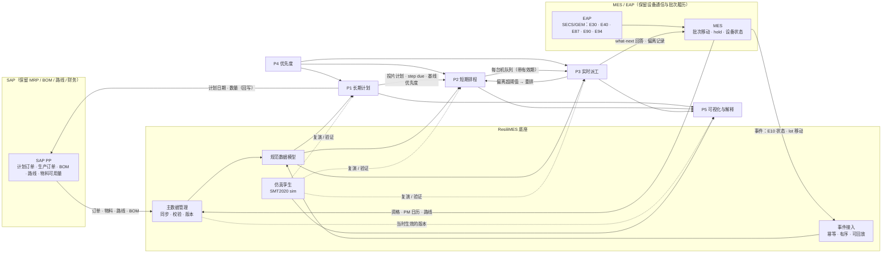

# 产品架构与可行性方案

本文讲 ResiliMES-AI 从比赛 demo 拆成几个产品之后，每个产品负责什么、彼此怎么接、和 SAP PP、MES 的边界在哪里，以及按两人团队的条件先做什么。初稿写完后，从三个视角各写了一份评审（fab 实务、软件架构、产品与商业），本文是按评审修改后的版本。评审要点和处理方式见文末附录。

本文是计划，不是现状说明。现状以代码和 [ARCHITECTURE_LAYERS.md](ARCHITECTURE_LAYERS.md)、[HARD_QTIME.md](HARD_QTIME.md) 为准。文中引用的数字都来自仓库现有文档，没有为本文重跑。

## 1. 结论

- 产品按五块划分：长期计划（P1）、短期排程（P2）、实时派工（P3）、优先度（P4）、可视化与解释（P5），下面共用一个底座（主数据管理、规范数据模型、仿真孪生、事件接入）。
- 这五块先作为一个 Python 包里的五个模块，边界用依赖规则卡住，不急着拆成五个服务。将来只有 P3 因为可用性要求单独部署。
- 第一个对外的产品是 **P5 解释与复演**：读现有 MES 的批次履历和设备状态，做延误和 Q-time 归因，再用仿真孪生复演改进方案。它接入最轻，和现有厂商重叠最少，也最接近我们已经做出来的东西。
- 第二步是 **P2 + P3 的瓶颈区域版本**（光刻、炉管批次、Q-time 链），先作为库在孪生里验证，有试点方再把 P3 做成服务。
- **P1 不作为独立产品先做**。先做“产能可行性和交期检查”这个功能。P1 的定位是 SAP PP 之上的计划层，不替代 PP；和 SAP PP/DS、IBP 的关系要先想清楚，见第 8 节。
- 动手拆模块之前，先补两件工程上的事：测试覆盖默认的 plan 模式；派工决策抽成仿真和服务都能调用的纯函数。
- 主数据管理放在底座里，不是第六个对外产品。五个产品都从这里读机台能力、日历、路线等准静态数据。真正的源头多半在 SAP 和 MES，这个模块负责同步、校验、补齐和按生效时间留版本，排程前把“机台没有资格却被排上”这类错误找出来。

## 2. 分层与时间范围

| 层 | 时间范围 | 运行频率 | 粒度 | 回答的问题 |
|---|---|---|---|---|
| P1 长期计划 | 整个产品周期，滚动。周期作为配置：前段晶圆通常 2–3 个月，加后段封测可到 6 个月 | 每周，必要时每天 | 产品 × 工序段 × 周/日；瓶颈机群产能 | 投多少片、什么时候投、交期能不能承诺 |
| P2 短期排程 | 承诺区几个小时（冻结区）；24 h–3 天作为滚动预测 | 每 5 分钟 tick 加事件触发 | 每台机 × 时间段 × 批次 | 哪台机什么时候做哪个 lot；Q-time、换型、PM、批次组批怎么排 |
| P3 实时派工 | 当前这一次决策 | 每个事件（机台空闲、lot 到达、Q-time 截止、down/PM 起止） | 一次 what-next 回答 | 这台机现在拿哪个 lot |
| P4 优先度 | 跟随各层 | P1 重算时更新基线；人工覆盖随时生效 | 每个 lot | 这个 lot 现在有多急，为什么 |
| P5 可视化与解释 | 跟随各层 | 按需 | 产能负荷、甘特图、单次决策 | 为什么这样排，换个做法会怎样 |

几条规则：

- 慢层的输出是快层的目标和约束，快层只补慢层看不到的东西。这和 [ARCHITECTURE_LAYERS.md](ARCHITECTURE_LAYERS.md) 的三层设计一致。
- P2 的“24 h–3 天”不承诺到每台机的每个时段。全厂范围的细排过几个小时就会被故障、返工、物料偏离掉。只有冻结区（现在 `freeze.py` 默认 2 个 load 或 30 分钟）是承诺的，冻结区外的部分是预测，用来看负荷和风险。
- P3 默认跟 P2 的队首走。偏离有固定的原因码。偏离超过阈值时，P3 用实时规则重选，并通知 P2 重排。
- **P3 不依赖 P2 才能工作。** P2 的计划带有效期，过期或缺失时，P3 退回本地规则（Q-time、hold、eligibility、PM 冲突、优先度），照常回答。P2 故障不能停线。

## 3. 数据流



## 4. 各产品的输入、输出和接口

### 底座

**规范数据模型。** 覆盖设备（机群、能力、腔体、端口）、lot（产品、片数、优先度、hold 状态）、路线（步骤、recipe、抽检）、recipe 与设备的资格、Q-time 窗口（起止步骤、上限、是否可补救）、PM 日历、设备状态（按 SEMI E10 分类：生产、待机、工程、计划停机、非计划停机、非排定）、BOM 和物料、光罩、载具与搬送时间。每个对象带外部 ID（SAP 或 MES 的编号）和模型版本号。

现在仓库里有两套结构：`resilimes/domain/models.py`（pydantic，样例车间和 CP-SAT 用）和 `resilimes/smt/fab.py`（SMT2020）。计划是新建一个 core 模型，两套现有结构各写一个适配器单向转入，不先改 `simulate.py` 内部。

**事件接入。** 现在没有。先定事件契约，再选传输：

- 每个事件带 `source`、`event_id`、`seq`、`occurred_at`、`received_at`。按 `(source, event_id)` 去重，按 `seq` 检测缺失。
- 事件类型先只做派工需要的：设备状态变化、lot 进出站、lot hold/release、Q-time 窗口开始、PM 开始结束。
- 传输可插拔：先用文件或 HTTP 回放仿真里已有的 `events`，有真实 MES 时再接消息队列。Redis 现在只在 `txn/store.py` 里做锁，不预设一定用 Redis Stream。

**仿真孪生。** 现有 `resilimes/smt/simulate.py` 和 `smt/twin.py`，基于 SMT2020，已经很成熟。在新架构里它有三个用途：P1/P2/P3 的离线验证，P5 的方案复演，以及没有真实 MES 时充当事件源。

**主数据管理。** 放在底座里，五个产品都从这里读，没有哪个产品单独持有一份。真正的源头多半在 SAP 和 MES，这里不另起一套从头录入。模块负责同步、校验、补齐，并按生效时间留版本；P5 复演时用当时那一版数据。

要管的内容：

- **机台能力**：每台机（必要时到腔体）能做哪些 recipe 和工步，每个工步要多长时间，batch 上限，以及 dedication 和 qualification。
- **可用时间**：班次日历、PM 计划、计划内停机，以及 MTBF/MTTR 这类统计值，排程时用来扣掉产能。
- **换线**：setup matrix，从哪个 recipe 换到哪个、要花多久。
- **工艺路线**：route、工步顺序、Q-time 约束（从哪一步到哪一步、最多等多久）。
- **产品和 lot 属性**：交期、优先度的初始值，以及和 SAP PP 物料主数据、BOM 的对应关系。
- **版本和生效时间**：每次改动都留版本，谁改的、从什么时候开始生效都记下来。

现状：这些字段已经散在 `domain/models.py`、`smt/fab.py`、`data/sample`、SMT2020 的 tool/route/setup/pmcal/downcal/attach，以及 `data/sql/kernel.sql` 的 `operations`、`setup_matrix`、`pm_calendar`。没有统一的版本、生效时间和校验入口，也没有和 SAP/MES 的同步。计划是新建 `mdm/` 模块，先对现有 SMT2020 和样例车间数据做校验，再补同步和版本。字段定稿和规范数据模型一起做。

### P1 长期计划

- 输入：SAP PP 的计划订单和生产订单、BOM、路线、物料可用量；底座的产能模型（瓶颈机群的可用时间，扣掉 PM 和预计停机）；P4 的基线优先度。
- 输出：投片计划（产品 × 数量 × 日期）、每个 lot 每一步的 step due、交期承诺和风险、产能负荷。
- 回写 SAP PP：计划订单的日期和数量。MRP、BOM、路线、成本仍由 PP 负责。接口方式按客户的 SAP 版本选（BAPI、IDoc 或 S/4HANA 的 OData API），这里不预设。
- 现状：`smt/planning.py` 已经有倒排（从 lot 交期反推每步的最晚完成）和基线优先度，但计划只在 t=0 算一次，没有滚动重算，也没有投片决策。`kernel/aps.py`、`kernel/erp.py` 在 ARCHITECTURE_LAYERS.md 里已经标为“naive and superseded”，不作为 P1 的基础。

### P2 短期排程

- 输入：P1 的 step due 和优先度、当前 WIP、设备状态、PM 日历、Q-time 窗口、组批候选、换型状态。
- 输出：每台机的有序队列（lot、计划开始、原因）、Q-time 保留（hold plan）、组批决定。冻结区内的部分标记为承诺，其余为预测。
- 现状：`smt/simulate.py` 的 `_Sim.tick`（每 300 秒仿真时间）加上 `build_schedule`，但只排到下一个 tick（p95 约 1.8–2.0 ms）；`hard_qtime.py` 的 Q-time 门控；`freeze.py` 的冻结区。默认模式下还有 71 次可避免的 Q-time 违规（三个种子合计，从 334 降到 111 再到 71，见 HARD_QTIME.md），这是 P2 对外之前必须解决的头号问题。
- `resilimes/domain/` 下的 list scheduler 加 CP-SAT 是另一套排程，只用于样例车间。计划是把 CP-SAT 保留为小窗口的最优参考，用来给 P2 的启发式打分，不再并行发展两套。

### P3 实时派工

- 输入：MES 的 what-next 请求（机台或端口）、该机台当前的 P2 队列（检查有效期）、实时状态、P4 优先度。
- 输出：选中的 lot（或组批）和原因；如果没跟 P2 的队首，再记一条偏离记录（时间、机台、计划 lot、实际 lot、原因码）。原因码沿用现有九个：`qtime_urgent`、`batch_ready`、`setup`、`not_arrived`、`ineligible`、`tool_down`、`pm`、`hold`、`schedule_stale`。
- 约束清单：Q-time、hold/inhibit、recipe 资格、PM 和计划停机冲突、光罩可用、组批规则、搬送时间。
- 服务要求：端到端（MES 发出请求到收到回答）p99 < 1 s；可用性 ≥ 99.9%，主备；同一请求重复到达时返回同一个回答（幂等）；每个回答可回放、可审计。仓库里的派工延迟数字（例如 SPONSOR_TECH.md 里 p95 0.0064 ms）是仿真内的计算时间，只是端到端预算中很小的一段，真实瓶颈是从 MES 拿到一致的 WIP 和设备状态。
- SECS/GEM 不由 P3 直接处理。设备通信是 EAP/MES 的事，P3 只消费 MES/EAP 给出的事件。E30/E40/E87/E90/E94 在这里只作为字段语义的参考。
- 现状：派工逻辑在 `simulate._Sim` 里（策略 `resilimes`、`edd`、`cr`、`fifo`、`smt_rule`，含 Q-time 优先、shortlist、reservation），`_Sim.deviation` 已经记录偏离但派工还不优先跟队首（“measured, not followed”）。`kernel/dispatch.py` 是早期版本。`txn/` 有基于 compare-and-set 的机台锁，`RedisStateStore` 可选，这是 P3 幂等和并发控制的起点。没有服务、没有事件流。

### P4 优先度

- 输入：订单类别和交期（来自 PP）、lot 当前进度、计划员的人工覆盖。
- 输出：每个 lot 的 band、rank 和紧急度，以及构成（哪些因素各占多少）。
- 必须支持人工覆盖：计划员把 lot 临时提为 hot 或 super hot，要填原因和到期时间，记录操作人；到期自动失效。
- 现状：`kernel/score.py`（DPI、CR、`class_tier`、`lot_value`，已经避免了交期被重复计算）和 `smt/planning.py` 的 band/rank（`priority_key`）。逻辑散在两处，没有人工覆盖，也没有审计记录。第一步是抽成一个模块，提供 `priority(lot, now) -> (band, rank, 构成)`，P1/P2/P3 都调它，先不做成服务。

### P5 可视化与解释

- 输入：P1 的负荷、P2 的计划、P3 的决策和偏离记录、MES 的批次履历和设备状态、孪生的复演结果。
- 输出：产能负荷图（P1）、甘特图和计划对实际（P2）、“为什么这个 lot 此刻被选中”（P3）、延误和 Q-time 归因、改进方案及其复演结果。
- 解释分两档，对外要写清楚：
  - **决策级**：用我们自己的 P2/P3 时，可以引用排程器的决策记录。
  - **结果级**：接第三方排程器或 RTD 时拿不到决策记录，只能做结果归因（延误分解、各步等待的原因），再用孪生复演方案。
- 现状：`insight/explainer.py`、`insight/gap_explainer.py`、`evidence/factcheck.py`、`evidence/lateness.py`；控制台是原生 JS，`resilimes/demo/static/app.js` 单文件 3,533 行。解释器能提的手段只有三个（`prioritise`、`clear_down`、`skip_pm`，`explainer.py` 第 28 行），README 里记录的结果是原因命中 11/12，但手段在复演里成立的只有 1/12。

## 5. 现有代码到产品的对应

| 产品 | 现有基础 | 状态 | 主要缺口 |
|---|---|---|---|
| 底座：主数据管理 | `domain/models.py`、`smt/fab.py`、`data/sample`、SMT2020 tool/route/setup/pmcal、`data/sql/kernel.sql` | 字段散在各处 | 统一入口、校验、版本和生效时间、SAP/MES 同步 |
| 底座：数据模型 | `domain/models.py`、`smt/fab.py`、`data/` | 两套并存 | 统一的 core 模型、外部 ID、版本 |
| 底座：孪生 | `smt/simulate.py`（3,022 行）、`smt/twin.py`、`smt/fsm.py` | 成熟 | 单文件过大；派工逻辑没抽出 |
| 底座：事件接入 | 仿真内 `events` 列表 | 没有 | 事件契约、去重、回放 |
| P1 | `smt/planning.py` 倒排和基线优先度 | 雏形 | 滚动重算、投片决策、产能模型、PP 接口 |
| P2 | `_Sim.tick`、`build_schedule`、`hard_qtime.py`、`freeze.py`；`domain/cpsat.py` | 可用（一个 tick） | 几小时的队列投影；71 次可避免 Q-time 违规 |
| P3 | `_Sim` 派工、`_Sim.deviation`、`txn/` | 可用（仅在仿真内） | 纯函数决策接口、服务、SLA、跟随队首 |
| P4 | `kernel/score.py`、`planning.priority_key` | 分散 | 独立模块、人工覆盖、审计 |
| P5 | `insight/`、`evidence/`、`api/`、`demo/static/` | 可用，主卖点 | 手段太少；结果级归因要能读外部数据；前端组件化 |

另外两点：测试共 632 个，但 `tests/conftest.py` 把 `RESILIMES_SCHED_MODE` 设成了 `strict_qtime`，而默认模式是 `plan`，所以默认路径没有被测试覆盖。AI 值班长在默认触发条件下被调用 0 次（README），默认运行不调用 LLM。规则排程是主体，这一点对外要如实说。

## 6. 模块边界与仓库调整

先做模块化单体，不拆服务。目标包结构（名称待定）：

```
resilimes/
  core/        规范数据模型、ID、版本、适配器（SMT2020、样例车间）
  mdm/         主数据：同步、校验、版本（读 SAP/MES，写入 core）
  twin/        仿真（从 smt/ 逐步迁入）
  priority/    P4
  planning/    P1
  scheduling/  P2
  dispatch/    P3 的决策函数（纯函数，无 I/O）
  explain/     P5 的归因和解释（insight/、evidence/ 迁入）
  ingest/      事件契约与回放
  api/         HTTP 接口
```

规则：

- 依赖方向：`core` 不依赖任何人；`mdm` 只依赖 `core`；`priority` 只依赖 `core`；`planning`、`scheduling`、`dispatch` 依赖 `core` 和 `priority`，读的是已经按生效时间展开的主数据快照；`explain` 可以读所有层（复演时向 `mdm` 取当时的版本），但不被它们依赖；`twin` 调 `dispatch` 和 `scheduling` 的同一套函数。用 import-linter 一类工具在 CI 里检查。
- 派工决策先抽成 `decide(snapshot, schedule, priority) -> Decision`，仿真和将来的 P3 服务调同一个函数。这样仿真结果就能直接验证 P3。
- 一次只搬一个模块，旧路径留转发，测试和 `study_*` 脚本不用同时改。`kernel/` 标为废弃，不再扩展。
- 搬迁前后，默认模式下固定种子的 KPI（完成数、on-time、可避免 Q-time 违规）必须一致，这作为每次搬迁的验收条件。
- 前端不重写。API 契约稳定之后，先把甘特图和 why 面板抽成独立组件。

## 7. 路线

### 近期（1–2 周）：打地基，不加功能

1. 测试在 `plan` 和 `strict_qtime` 两种模式下都跑；为默认模式加固定种子的 KPI 回归基线。
2. 写规范数据模型和主数据实体文档（字段、ID、E10 状态映射、校验规则），先不写代码迁移。对 SMT2020 和样例车间跑一遍现有数据的校验，把资格缺失、路线和 Q-time 对不上、换型矩阵缺边这类问题列出来。
3. P4 抽成 `priority` 模块，统一 `kernel/score.py` 和 `planning.priority_key` 的入口，结果和现在逐位一致。
4. 派工决策抽成纯函数接口，仿真改为调用它，KPI 不变。
5. 定事件契约，用仿真 `events` 写一个回放器。

完成标准：上面五项都有测试，默认模式 KPI 和现在一致；主数据校验能在现有数据集上跑通并给出问题清单。

### 中期（1–2 个月）：做出第一个能给人看的产品

1. P5 结果级归因：只用“批次履历 + 设备状态 + PM 日历”这类 MES 常见数据，在 SMT2020 上做延误和 Q-time 归因，不依赖我们自己的决策记录。
2. 解释器手段从 3 个扩到 6–8 个（例如换机台、调组批、调 PM、改投片时间），每个方案都先在孪生里复演，通过才展示。原因对不对、方案能不能落地、引用是否完整，这三项分开评分。
3. P2：继续消除 71 次可避免的 Q-time 违规（按 HARD_QTIME.md 里的分类逐条处理）；队列投影从一个 tick 扩到 2–4 小时，先只做光刻、炉管批次和 Q-time 链所在区域。
4. P3：派工改为默认跟随队首，偏离按原因码记录，在孪生里量化跟随率和对 KPI 的影响。
5. 业务验证：做 3–5 次 fab 计划或 IE 人员访谈，找一个能提供半真实数据的试点。
6. 主数据：补上版本和生效时间；提供文件或手工导入的同步入口，SAP/MES 的自动同步先做样例，不按客户定制。

完成标准：P5 在 SMT2020 上能用“只有 MES 数据”的输入跑通；有访谈记录和一个试点候选；主数据能按时间取出当时的版本。

### 长期（中期之后，视试点而定）

1. 有试点时，P3 单独部署成服务：主备、幂等、端到端 SLA 监控、决策回放。
2. P1 产能可行性和交期检查：滚动重算 step due（现在只在 t=0 算一次），投片建议，和 SAP PP 的计划订单往返样例。
3. P1 是否做成完整的计划产品，等访谈和试点结果再定。
4. 前端组件化。

## 8. 市场位置与 SAP PP 的关系

- RTD 和短期排程有成熟厂商，例如 Applied Materials 的 SmartFactory 系列、INFICON 的 FPS、Siemens Opcenter APS。P2/P3 和它们正面竞争，要靠 Q-time 处理和可解释性取胜，接入和验证周期长。所以放在第二步，先在孪生里证明效果。
- 长期计划这边，SAP 自己有 PP/DS 和 IBP，另外还有 Kinaxis、o9，日本市场还有 Asprova。“在 PP 之上做计划层”会直接碰到 PP/DS。所以 P1 先作为一个功能（产能可行性、交期检查）存在，SAP 集成作为实施和咨询能力。
- P5 解释与复演和这些系统是互补关系，可以挂在客户已有的 RTD 或 APS 之上，所以先做。
- Zetaris 和 Nightshift 是比赛时的赞助技术，数据源和 LLM 都要可替换，不作为卖点。

## 9. 风险

| 风险 | 影响 | 应对 |
|---|---|---|
| 71 次可避免 Q-time 违规没清掉 | P2/P3 对外不可信 | 中期第 3 项；清掉之前不对外推 P2/P3 |
| 没有真实 fab 数据 | 所有结论只在 SMT2020 上成立 | 访谈和试点；P5 先做只依赖 MES 常见数据的版本 |
| 两人团队 | 五块同时做必然半途 | 一次只推一个产品；先模块化单体 |
| 重构打坏现有结果 | 已有研究和数字失效 | 固定种子 KPI 基线，逐模块搬迁 |
| 第三方系统拿不到决策记录 | 解释深度下降 | 对外写明两档解释 |
| SAP 集成方式因客户而异 | P1 工作量不可控 | 只做一个往返样例，其余按项目实施 |
| 解释方案复演通过率低（现在 1/12） | P5 的价值打折 | 扩手段，未通过复演的方案不展示 |
| 主数据和现场不一致 | 排程结果不可信，P5 复演对不上当时条件 | 排程前先校验，有错先报出来；复演取当时版本，对不上就标明数据缺口 |

## 附录：评审意见与处理

三份评审都针对初稿 v1，各自只从一个视角写，写完之后才修改。评审由同一个助手按三个视角分别完成，没有外部专家参与，这一点如实说明。

### A. fab 制造 / MES-RTD 实务

| 意见 | 严重度 | 处理 |
|---|---|---|
| v1 让 P3 依赖 P2；真实 fab 里 P2 挂了 RTD 也要照常回答 | 高 | 已采纳：P2 计划带有效期，过期退回本地规则（第 2、4 节） |
| 引用的 ms 级延迟是仿真内计算，真实瓶颈是 MES 数据延迟和一致性 | 高 | 已采纳：定义端到端 SLA p99 < 1 s、可用性 ≥ 99.9%（第 4 节）。具体数值是初定，要按试点 MES 校准 |
| 全厂 24 h–3 天逐台细排不稳定 | 中 | 已采纳：冻结区承诺，其余为预测；先做瓶颈区域（第 2、7 节） |
| SECS/GEM 是 EAP/MES 的事 | 中 | 已采纳：P3 只消费事件，去掉“自研 SECS/GEM 适配器” |
| 缺人工改优先级 | 中 | 已采纳：P4 加人工覆盖、原因、到期、审计 |
| 产品周期口径 | 低 | 已采纳：周期作为配置 |
| 漏了光罩、搬送、hold/inhibit | 低 | 已采纳：列入数据模型和 P3 约束清单 |

### B. 软件架构

| 意见 | 严重度 | 处理 |
|---|---|---|
| 五个服务两人维护不了 | 高 | 已采纳：模块化单体，只有 P3 将来单独部署（第 6 节） |
| 数据模型两套并存，v1 没选 | 高 | 已采纳：新建 core 模型 + 两个适配器。字段细节留到近期第 2 项，尚未定稿 |
| 测试不覆盖默认 plan 模式 | 高 | 已采纳：近期第 1 项，作为所有重构的前提 |
| 派工逻辑埋在 `_Sim` 里 | 中 | 已采纳：先抽纯函数 `decide()`，仿真和服务共用 |
| 先定了传输（Redis Stream）没定契约 | 中 | 已采纳：先定事件 schema 和幂等键，传输可插拔 |
| P1 错误地映射到已废弃的 `kernel/` | 中 | 已采纳：改为基于 `smt/planning.py`，`kernel/` 标废弃 |
| 搬文件打断 import | 低 | 已采纳：旧路径留转发，一次一个模块 |
| 前端重写 | 低 | 已采纳：不重写，先抽组件 |

### C. 产品 / 商业

| 意见 | 严重度 | 处理 |
|---|---|---|
| 五个产品同时推进，没说先卖哪个 | 高 | 已采纳：先做 P5 解释与复演，P2/P3 第二，P1 暂作功能（第 1、8 节） |
| “PP 之上的 APS”撞上 SAP PP/DS、IBP 和 Kinaxis、o9、Asprova | 高 | 部分采纳：P1 暂不做独立产品。P1 最终怎么和 PP/DS 分工，仍是开放问题，等访谈后再定 |
| 第三方排程器拿不到决策记录 | 中 | 已采纳：解释分决策级和结果级两档 |
| 没有客户验证 | 中 | 已采纳：中期做 3–5 次访谈、找试点。还没开始 |
| 围绕赞助方设计 | 中 | 已采纳：数据源和 LLM 可替换 |
| 对外别主打 AI | 低 | 已采纳：如实写明规则排程是主体，AI 值班长默认调用 0 次 |

### 仍未解决的问题

- P1 和 SAP PP/DS 的分工。
- P3 的 SLA 数值，需要真实 MES 校准。
- 规范数据模型和主数据实体的字段定稿。
- 71 次可避免 Q-time 违规能否在不损失产出的前提下清掉。HARD_QTIME.md 里记录过一个更严的门控方案，违规减少了，但产出跌到每次 130–280 lots，所以没有采用。
